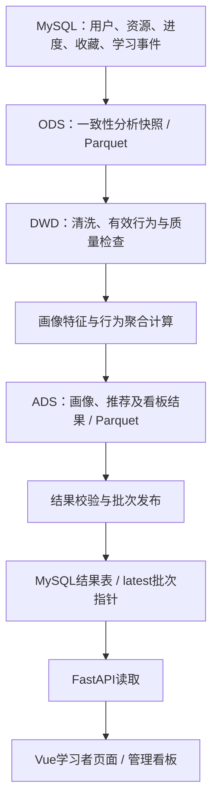

# 大数据智能学习平台系统

**大数据技术专业毕业设计 · 学习行为分析 · 用户画像 · 个性化资源推荐**

本项目的研究主题为“基于 Spark 的学习行为分析与个性化资源推荐系统设计与实现”。采用 Vue 3、FastAPI、MySQL 与 PySpark，构建从在线学习、行为采集到离线分析、推荐发布及可视化展示的完整链路。

## 项目简介

在线学习平台通常积累了浏览、学习开始、完成与收藏等行为，但仅提供资源列表难以反映学习者兴趣与资源使用情况。本项目将这些行为转化为可分析的数据快照，通过 Spark 清洗、聚合和画像计算，为学习者提供带有推荐理由的资源建议，为管理员提供学习行为统计。

系统目标是形成可解释、可追溯、适合本科毕业答辩演示的闭环：**学习操作 → 行为记录 → 批次分析 → 画像与推荐 → 页面展示**。结果包含批次和来源信息，避免将离线结果误认为实时重算。

当前定位为本机运行的毕业设计系统。已实现功能不等同于生产集群性能或真实用户研究结论。

## 技术架构

| 层次 | 实际技术与职责 |
|---|---|
| 前端 | Vue 3、TypeScript、Vite、Element Plus、Pinia、Vue Router、Axios、ECharts |
| 后端 | Python、FastAPI、Uvicorn、SQLAlchemy、PyMySQL；JWT认证与角色权限 |
| 数据库 | MySQL 8、InnoDB、utf8mb4；SQL脚本迁移 |
| 大数据分析 | PySpark / Spark 3.5.7、Spark SQL、Parquet、JDBC；本机local[2]批处理 |
| 推荐 | 热度基线popular_v1、融合标签相似度/个人行为/热度的content_v1 |
| AI扩展 | 后端对接Agnes模型；课程资料关键词检索、引用与个人问答历史 |
| 验证 | 后端与Spark pytest，前端Vitest、TypeScript检查与Vite构建 |

Hadoop HDFS是项目中的教学课程主题；当前数据链路使用本地Parquet文件，不能据此宣称部署了HDFS或Hadoop集群。没有实现ALS推荐或向量检索。

## 系统功能

| 模块 | 已实现能力 |
|---|---|
| 用户模块 | 注册、登录、JWT认证、兴趣标签；学习者与管理员权限隔离 |
| 课程与资源 | 搜索与筛选、资源详情、章节目录、Markdown教学正文、目标/示例代码/练习、视频播放、手动完成与章节进度 |
| 学习行为 | 浏览、开始、完成、收藏/取消收藏；事件校验、幂等与事务处理 |
| 数据处理 | MySQL五表分析投影快照、行为清洗与质量检查、独立批次及来源追踪 |
| 用户画像 | 标签兴趣、学习行为统计及批次结果；在推荐页面配套展示 |
| 个性化推荐 | 热度与融合内容推荐、推荐理由、已完成资源过滤、时间划分离线实验 |
| 管理与看板 | 用户和资源管理、课程/章节编辑与发布、行为统计图表和批次来源展示 |
| AI学习助手 | 通用问答与课程问答；课程资料外发确认、资源许可、额度、引用与历史；不自动改变学习进度 |

正式课程视频共 **5门课程、25章**，采用1280×720、16:9规格。最新节奏优化版本验收为 **视频25 / 缺失0 / 异常0 / 通过25**，详见[最终替换报告](outputs/course-teaching-rhythm-final-replacement-report.md)。新增旁白字幕作为独立SRT留在候选交付目录，当前播放器不自动加载这些字幕文件。

## 大数据处理流程



实际落盘层为 **ODS → DWD → ADS**；中间聚合在任务内完成，没有独立DWS目录。抽取针对分析所需字段，不是数据库完整备份。各任务校验成功后发布，保留历史批次；网页刷新不触发Spark重新计算。课程章节事件与主分析五表之间存在桥接规则，不把全部章节事件直接等同于Spark输入。

## 项目目录结构

```text
BigDataGraduationProject/
├── backend/                 # API、服务、ORM、认证、工具与测试
├── frontend/                # Vue页面、组件、路由、测试
│   └── public/videos/       # 五门课程的25个正式MP4
├── spark/                   # jobs、utils、configs、tests、README
├── database/                # migrations/001–007、种子与数据库说明
├── configs/                 # 安全默认模板；本机私有配置不提交
├── scripts/                 # 启动、策略配置及教学资料工具
├── docs/                    # 架构、阶段设计、部署与答辩指南
├── outputs/                 # 最终报告/证据白名单；生成产物忽略
├── screenshots/             # GitHub展示截图，当前为占位目录
├── tests/                   # 根测试预留；主要测试在各模块下
├── data/                    # 本机分层数据，忽略Git
├── environments/            # 本机环境与安全加载工具，部分忽略
├── work/                    # 临时产物，忽略Git
├── wsl/                     # 本机WSL存储，忽略Git
├── spark-experiments/        # 本机环境实验产物，忽略Git
├── code/                    # 历史环境预留目录
├── start-project.bat        # Windows本机启动入口
└── README.md
```

项目没有独立`sql/`目录，迁移SQL位于`database/migrations/`。以上为本机真实结构；被忽略的运行目录不一定出现在GitHub检出结果中。

## 部署环境

- 当前部署方式：Windows + WSL2 Ubuntu 22.04，Windows MySQL 8，Java 17，Python 3.11，Node.js 22。
- Python依赖以[backend/requirements.txt](backend/requirements.txt)及开发依赖为准；前端以`package-lock.json`恢复，Node要求`>=22.12.0 <23`。
- Spark使用本地模式；Connector/J须单独恢复，见[Spark说明](spark/README.md)。未提供已验收的生产集群或容器化部署。
- 本机可双击`start-project.bat`启动；数据库、已有WSL环境、依赖和安全凭据需提前准备。
- 前端：`http://localhost:5173`；后端接口文档：`http://localhost:8000/docs`。
- 新机器需根据[数据库说明](database/README.md)恢复迁移与必要教学数据，不能将源码检出视为数据库已经恢复。已有数据库不要重复执行初始化。
- 数据库密码、JWT_SECRET及AI密钥通过本机安全机制加载，禁止写入README、截图或提交。AI需要有效模型配置与网络条件。

详细安装、启动、测试和开发约束保留在下方“部署与维护参考”中；本次仅修改展示文档，没有执行迁移、启动分析任务或重新验收全系统。

## 系统截图

截图目录为[`screenshots/`](screenshots/)。目前未添加真实截图，仅保留`.gitkeep`，因此不展示虚构截图或失效图片链接。

| 待补充截图 | 建议文件名 | 对应真实页面 |
|---|---|---|
| 登录页面 | login.png | /login |
| 首页 | home.png | / |
| 课程列表与章节学习 | courses.png、course-learning.png | /resources、/resources/:id/learn |
| 用户画像 | user-profile.png | /recommendations中的画像区域，无独立画像路由 |
| 推荐页面 | recommendations.png | /recommendations |
| 管理看板（可选） | dashboard.png | /dashboard，管理员权限 |

截图仅使用真实运行页面，隐藏密码、密钥、令牌及个人敏感信息。采集建议见[论文截图清单](docs/thesis-screenshot-checklist.md)。

## 项目文档与验收

- [总体架构](docs/system-final-architecture.md)
- [最终验收与答辩指南](docs/final-project-acceptance-guide.md)
- [系统验收报告](outputs/final-system-acceptance-report.md)
- [答辩验收报告](outputs/defense-final-acceptance-report.md)
- [正式批次发布报告](outputs/formal-release-result-report.md)
- [最新视频验收](outputs/course-teaching-rhythm-final-replacement/acceptance/acceptance-20261010T152724331653Z.md)
- [答辩演示脚本](outputs/graduation-defense-demo-script.md)

历史报告记录各阶段当时状态，不能替代最新视频版本证据或本机演示前检查。精确测试数量与未验证项请以对应报告范围为准。

## 作者信息

**nuyoahyanxi-design**

大数据技术专业毕业设计

---

## 部署与维护参考

以下保留既有README中的详细部署与开发说明，版本性结论按上方最新验收入口核对。

<details>
<summary>展开：环境恢复、启动、测试、课程管理与AI配置</summary>

## 技术栈

- Windows + WSL2 Ubuntu 22.04；Java 17、Python 3.11、PySpark/Spark 3.5.7、Spark SQL、Parquet。
- 前端：Vue3、TypeScript、Vite、Element Plus、Pinia、Vue Router、Axios、ECharts；固定版本见frontend/package-lock.json。
- 后端：FastAPI、SQLAlchemy、PyMySQL、Uvicorn、PyJWT；固定版本见backend/requirements*.txt。采用SQL脚本迁移，没有实现Alembic自动迁移。
- 数据库：MySQL 8.0；开发工具：VS Code WSL、Node.js 22、Git。

## 目录说明

| 目录 | 作用 |
|---|---|
| frontend | Vue页面、路由、认证状态、API封装、单元与集成测试 |
| backend | FastAPI接口、事务服务、ORM、认证及后端测试 |
| spark | jobs任务、utils计算工具、configs参数、tests及lib JDBC驱动 |
| database | migrations/001、002、003与数据库说明 |
| data | 分层数据，不纳入Git |
| configs | 根配置预留；实际Spark参数位于spark/configs |
| tests | 根测试预留；实际测试位于backend/tests、frontend/tests、spark/tests |
| docs | 各阶段设计、总体架构、环境与论文截图清单 |
| outputs | 最终报告与验收证据按.gitignore白名单提交；实验与中间产物忽略 |
| work | 既有环境工具与临时产物，不纳入Git |
| environments | 已有激活与安全凭据工具，本轮不修改，不纳入Git |
| wsl | 已有虚拟磁盘与Swap，本轮不修改，不纳入Git |
| spark-experiments | 已有环境验收数据，本轮不修改，不纳入Git |
| code | 环境阶段遗留空目录，保留，不作为正式源码根目录 |

Git不记录空目录。data、outputs中的非白名单产物、虚拟环境、node_modules、JDBC二进制及WSL磁盘等不随源码提交；交付时应单独保留必要报告及注明来源的数据。不要把源码检出当作已恢复数据库和凭据。

## 开发规范

1. 按确认的MVP和阶段完成标准开发，以真实运行证据报告状态。
2. 后端负责权限和事务，Spark实际负责清洗、聚合、画像特征、热度与内容推荐。
3. 首版一个前端、一个后端、一个数据库和一个独立批处理执行器，不拆微服务。
4. 批次冻结输入和截止时间，结果带batch_id；全部校验通过后发布，失败保留旧结果。
5. 平台、公开、模拟数据分别记录；实验采用时间划分，不使用未来状态回填历史。
6. 时间保存为UTC，业务日期聚合明确使用Asia/Shanghai。
7. 凭据使用安全存储和进程环境变量，不写入源码、文档、日志或提交。
8. 虚拟环境、node_modules、数据、WSL磁盘和日志不提交。临时产物放work，交付物放outputs。
9. 命名使用英文；依赖按当前清单和lockfile恢复，不为追新升级。
10. 测试重点为权限、幂等、事务、批次发布、候选过滤和实验边界。
11. AI助手已作为扩展模块实现；ALS、自动测验、精确时长归因与集群性能不作为当前验收能力。
12. 提交前检查差异和忽略规则，提交说明描述具体改动及验证结果。

## 环境使用

在Ubuntu终端执行：

```bash
source /mnt/d/BigDataGraduationProject/environments/activate-bigdata.sh
cd /mnt/d/BigDataGraduationProject
```

Windows根目录为D:\BigDataGraduationProject。已有快捷方式仍指向code空目录，本轮保留；正式开发请在WSL窗口打开项目根目录或对应源码目录。

## 项目文档

- [项目概览与MVP](docs/project-overview.md)
- [开发计划](docs/development-plan.md)
- [环境说明](docs/environment.md)

## 安装与恢复顺序

现有本机已配置完整环境，直接使用下方启动流程，不重建虚拟环境、不重复迁移、不重新安装WSL。以下用于新机器恢复，尚未在全新机器执行验收：

1. Windows启用WSL2并安装Ubuntu22.04；MySQL8.0运行在Windows。准备项目目录D:\BigDataGraduationProject，在WSL中对应/mnt/d/BigDataGraduationProject。
2. Ubuntu安装git、curl、wget和OpenJDK17；JAVA_HOME使用/usr/lib/jvm/java-17-openjdk-amd64。安装Python3.11及venv组件，不替换系统Python；新机器建立独立bigdata-graduation-env。当前本机虚拟环境为/home/nuyoah/.venvs/bigdata-graduation-env，必须复用。
3. 安装Node22.22.2与npm10.9.7，保持Node22版本线；准备VS Code及Remote WSL、Python、Vue扩展。
4. 将MySQL设置为utf8mb4，准备bigdata_graduation数据库及专用账号；新空库按database/README.md及对应模块指南依次恢复001–007迁移。已有数据库先备份检查，禁止重复迁移或关闭外键强行覆盖。
5. 在已激活Python环境恢复依赖：`python -m pip install -r backend/requirements-dev.txt`，`python -m pip install pyspark==3.5.7`；运行`python -m pip check`。前端在frontend执行`npm ci`，使用已有lockfile。
6. 恢复Spark JDBC驱动到spark/lib/mysql-connector-j-8.0.33.jar，官方Maven坐标com.mysql:mysql-connector-j:8.0.33；SHA256为e2a3b2fc726a1ac64e998585db86b30fa8bf3f706195b78bb77c5f99bf877bd9。该JAR被Git忽略，不要误判为已随源码交付。
7. 安全设置MYSQL_HOST、MYSQL_PORT、MYSQL_DATABASE、MYSQL_USER、MYSQL_PASSWORD、MYSQL_CHARSET=utf8mb4及JWT_SECRET。密码仅通过安全存储或私密进程环境注入，禁止放在命令参数、报告、源码和VITE_变量中。本机activate-bigdata.sh私密加载数据库配置，backend/run.py加载Windows JWT安全凭据；两者绑定当前Windows环境，移机不能直接假定可用。
8. 前端开发配置使用frontend/.env.example；可在本机私有.env.local设置API_PROXY_TARGET=http://127.0.0.1:8000，VITE_API_BASE_URL=/api，不包含密码。也可按下方命令临时设置代理地址。

本阶段没有安装或升级依赖。无需Docker，docker-desktop发行版保留。

## 本机启动步骤

先确认Windows服务MySQL80正在运行。打开三个WSL终端；各自先激活已有环境，不要打印全部环境变量。

后端终端：

```bash
source /mnt/d/BigDataGraduationProject/environments/activate-bigdata.sh
cd /mnt/d/BigDataGraduationProject/backend
python run.py
```

后端地址http://localhost:8000/docs。启动会验证MySQL连接；直接`uvicorn app.main:app`需要另行安全提供JWT_SECRET，不能省略配置。

前端终端：

```bash
source /mnt/d/BigDataGraduationProject/environments/activate-bigdata.sh
cd /mnt/d/BigDataGraduationProject/frontend
API_PROXY_TARGET=http://127.0.0.1:8000 npm run dev -- --host 0.0.0.0
```

Windows浏览器打开http://localhost:5173/login。0.0.0.0用于Windows访问WSL开发服务，只适用于受控本机开发网络，不是生产部署方案。Vite代理/api到FastAPI；不写死浏览器后端主机、不需要把JWT传入URL。

Spark终端（前两服务可继续运行；不要与业务写入测试并行抽快照）：

```bash
source /mnt/d/BigDataGraduationProject/environments/activate-bigdata.sh
cd /mnt/d/BigDataGraduationProject
python -m spark.jobs.pipeline
python -m spark.jobs.user_profiles
python -m spark.jobs.recommendations
python -m spark.jobs.dashboard_metrics
```

每步成功才进入下一步。推荐和看板读取已发布批次；页面刷新不会自动重算。结果见outputs/*-latest.json、data/ods、data/dwd、data/ads。没有独立落盘的DWS层。配置位于spark/configs。Spark为local[2]、driver1g，单表抽取上限50000行；用于本机MVP，不宣称集群性能。

停止前后端按Ctrl+C；不要停止或删除MySQL/WSL发行版来退出项目。Spark任务正常结束会释放会话。

## 演示流程

1. 用既有学习者账号登录，展示当前角色及兴趣标签。没有公共默认管理员密码，凭据不要出现在截图里。
2. 浏览/resources，搜索、筛选并进入详情；演示开始、收藏/取消收藏、完成。完成须先开始。
3. 使用已授权接口或数据库只读结果展示该用户新增learning_events，重点展示UUID、类型、时间、is_effective；不展示Authorization头。
4. 顺序运行四个Spark任务，展示源批次、清洗质量、Parquet、画像与推荐发布成功记录。
5. 打开/recommendations，展示该学习者的推荐理由、算法、分数与配套画像。已完成资源会过滤；样本少时结果为空可能是正常状态。
6. 用管理员账号登录，展示/dashboard统计、更新时间和来源，再到/admin查看用户、编辑资源与发布/下架。资源维护不自动改变冻结批次统计。
7. 展示独立实验配置、时间划分和指标，明确合成数据来源。已有模拟训练/测试批次可执行下方命令；不得把其模拟ID用于线上登录：

```bash
python -m spark.jobs.recommendation_experiment --train-batch 20261002T235959Z_6b8ead93 --test-batch 20261003T235959Z_27f0f6d4
```

上述命令依赖当前本机保留的合成批次；新机器可按spark/README.md运行既有prepare_experiment_data任务恢复。默认实验使用线上样本时测试标签可能为空，Recall/NDCG=null表示不可计算，不是假定0。

## 测试与交付依据

WSL激活环境后，从backend执行`python -m pytest tests -q`；项目根执行`python -m pytest spark/tests -q`；运行后端服务后，在frontend执行：

```bash
AUTH_API_TARGET=http://127.0.0.1:8000/api AUTH_TEST_PYTHON=/home/nuyoah/.venvs/bigdata-graduation-env/bin/python PYTHONPATH=/mnt/d/BigDataGraduationProject/backend npm test
npm run build
```

测试创建限定临时数据并清理，Spark测试可能生成新实验及发布记录，应在备份后于开发环境运行。部分验收测试绑定初始小样本数量；正式演示增加数据后不能将固定样本断言失败等同算法错误。全量业务测试完成后再抽取最终快照，避免把临时测试账户纳入分析。

最终架构：docs/system-final-architecture.md。最终验收：outputs/final-system-acceptance-report.md。论文截图清单：docs/thesis-screenshot-checklist.md。阶段设计与报告保持历史记录，不覆盖成最终批次。实际版本、测试数量、批次与限制以最终验收报告为准。

## Windows一键启动（含AI安全输入）

在当前Windows电脑双击根目录 **start-project.bat**，无需管理员权限。默认使用WSL发行版Ubuntu-22.04，MySQL80须已启动，前端依赖须已安装。

1. 启动器检查MySQL、项目位置和端口。已经正常运行的后端及Vite会直接复用；未启动时分别打开“Spark Learning - backend”和“Spark Learning - frontend”终端。
2. 后端调用现有outputs/start-ai-real-model-secure.py，保留环境变量优先、缺失时隐藏输入的安全机制。按窗口提示输入Agnes model（agnes-3.0-flash）及API Key，自行安全保管，**不要写入bat、源码、文档或Git**。首次配置保存到被Git忽略的.env.local，后续自动加载。另一个WSL终端临时export的配置不会自动传入新窗口；Windows启动器继承其启动进程的系统环境变量。
3. 等待后端、首页和/api代理就绪后，自动打开http://localhost:5173。默认等待300秒；等待期间请完成后端安全输入。超时后终端保持打开，可查看错误，完成输入后再次双击即可复用服务。
4. 主启动窗口按Enter关闭，服务继续运行。停止服务请在对应服务终端按Ctrl+C，再关闭终端；不用停止MySQL或WSL。不要关闭正在提供服务的后端窗口。

实际执行仍为既有Python环境的后端安全启动、frontend/npm run dev；不会执行数据库迁移、Spark任务、依赖安装或测试数据写入。已有后端可能处于AI关闭状态；复用不会自动改变其AI配置，需自行通过安全启动脚本重启后端。打开登录页后使用原有账号密码。

可选参数（在项目根目录PowerShell执行）：

```powershell
# 只检查现有服务，不启动、不打开浏览器
.\start-project.bat -CheckOnly -NoPause
# 正常启动但暂不打开浏览器
.\start-project.bat -NoBrowser
# 给安全输入留更长时间
.\start-project.bat -WaitTimeoutSeconds 600
# 启动检查工具测试，不读Key、不启动服务
powershell.exe -NoProfile -File .\scripts\test-start-project.ps1
```

辅助文件：scripts/start-project.ps1负责Windows调度与就绪检查，scripts/start-project-service.sh负责WSL环境激活与服务执行。端口被其他服务占用、代理异常、MySQL未运行时会报错，不强行结束进程或修改服务配置。Windows执行策略若阻止本地PowerShell脚本，请检查组织策略或联系管理员；启动器不会修改或绕过执行策略。

本机验证记录：[一键启动验收报告](outputs/windows-one-click-start-acceptance-report.md)。

## 完整课程教学章节

三门演示课程（Spark RDD基础教程、PySpark数据处理实践、Python机器学习基础）各5章，提供教学目标、知识点、Markdown讲解、独立Python/PySpark代码示例及自主练习。资源详情进入/resources/:id/learn，选择章节阅读并使用既有完成按钮；练习不自动评分，页面不执行示例代码。

每章video_url暂为/demo/video.mp4，本项目没有生成此视频文件。播放器加载失败时可继续阅读；后续自行准备文件再放至frontend/public/demo/video.mp4。代码适用Python3.11/PySpark3.5.7；Spark示例在已有spark会话中执行，机器学习基础示例仅用标准库，小数据不是平台算法评价结果。

迁移与教学内容初始化见database/README.md的006说明。只改课程章节教学字段，不改用户/资源表、学习记录、推荐算法或Spark链路。原教学内容备份及验收见outputs/course-teaching-*；设计见docs/course-teaching-content-design.md。

正式课程章节已补充至5门共25章：Spark、PySpark、Python机器学习各5章，MySQL数据库基础（1071）与Hadoop HDFS入门（1070）各5章。后两门的初始化与只读核验命令见database/README.md。“Spark真实浏览器联调演示资源”保持无章节，不作为正式课程种子。视频继续使用/demo/video.mp4占位；课程练习内容不会自动在平台数据库或HDFS执行。

### 管理员课程与章节维护

管理员登录后访问 `/admin/courses`，或从管理员后台点击“进入课程与章节管理”。课程管理可搜索、分页、创建/修改课程及发布/隐藏；隐藏对应已有offline状态，不删除学习数据。

选择“管理章节”后可填写章节标题、排序、视频URL、知识点、教学目标、Markdown正文、示例代码和练习。教学目标与练习每行一项；知识点以逗号分隔。视频支持已有本地静态资源地址，例如/demo/video.mp4（占位）或/videos/lesson.mp4；本模块不上传或生成视频。

无章节学习记录的课程可新增、重排和删除章节，删除需二次确认。课程一旦产生章节进度或事件，目录冻结：仍可修订教学内容，但不能增删或重排，避免破坏原有学习进度。修改教学内容不会使已完成章节自动变成未完成。

新增章节维护接口：PUT、DELETE /api/resources/{id}/chapters/{chapter_id}，均仅管理员可用。课程信息及状态维护复用原资源接口，无需数据库迁移。前端Vite刷新加载页面；已有后端需按原安全方式重启才能加载新增接口。一键启动会复用已有进程，请先停止旧后端服务。

设计和验收记录：docs/admin-course-management-design.md、outputs/admin-course-management-acceptance-report.md。

### 管理员正式教学资源列表口径

课程管理页的列表来自管理员专用GET /api/admin/courses，读取resources中未删除的教学资源，不再以resource_type=course筛选。现有正式课程1068—1072的原类型document保留，各有5章。页面显示章节数量和更新时间；无章节的正式资源也可管理并新增第一章。

课程管理列表/搜索/分页总数专门排除数据库验收资源1—6与联调资源406；这些数据仍可在原管理员资源管理中查看，不被删除。编辑已有教学资源保留原类型，创建新课程仍使用course类型。

修正记录：docs/admin-course-list-correction-design.md、outputs/admin-course-list-correction-acceptance-report.md。新增后端查询路径需重启原后端进程，再刷新前端页面。

### 管理员课程多页面操作

`/admin/courses` 仅显示课程列表。点击“编辑课程”进入 `/admin/courses/:id/edit`，保存课程信息并发布或隐藏；点击“管理章节”进入 `/admin/courses/:id/chapters`，查看章节、发起新增或删除。复杂教学内容在 `/admin/courses/:courseId/chapters/:chapterId/edit` 独立编辑，每页均有返回按钮。

创建课程使用 `/admin/courses/new`；新增章节使用 `/admin/courses/:courseId/chapters/new`。创建成功自动进入对应编辑页，后续保存更新已创建记录。刷新编辑页可直接按 URL 读取数据。所有页面沿用管理员权限与原 API，学习者进入403页面，未登录转登录；已有学习记录的增删、排序保护不变。此次页面调整无需数据库迁移，前端刷新即可加载。

设计：docs/admin-course-multipage-design.md；验收：outputs/admin-course-multipage-acceptance-report.md。

### Agnes 本地配置：首次输入，后续自动加载

双击 `start-project.bat`。首次启动后端时，在后端窗口输入 `AGNES_MODEL`（例如 `agnes-3.0-flash`）及 API Key；Key 输入隐藏。验证通过自动生成项目根目录 `.env.local`，以后启动不再询问。可单独运行以下命令完成配置：

```powershell
powershell.exe -NoProfile -File D:\BigDataGraduationProject\scripts\start-project.ps1 -ConfigureOnly
```

加载优先级按字段为：非空系统环境变量 > `.env.local` > 手动输入。模型变量使用 `AGNES_MODEL`，兼容旧 `AGNES_MODEL_ID`；两者存在时前者优先。Windows进程环境通过WSLENV传给Ubuntu，Key不作为命令行参数。已有本地有效值不会被临时环境覆盖反写。

`.env.local.example` 仅包含模板。真实 `.env.local` 是被Git忽略的本地明文配置，启动器不依赖Windows权限模块；请勿上传、截图或分享此文件。不要把真实值填到example。原有Ubuntu启动命令 `PYTHONPATH=backend python outputs/start-ai-real-model-secure.py` 也使用同一加载顺序。

文件缺失提示首次配置；模型/Key为空时明确提示补充输入，仍为空或非法则停止。缺字段修复保留原有效值。需要更换已有本地配置时在本机自行编辑 `.env.local`，或安全保管旧文件后再配置；启动器不会自动删除已有凭据。请使用个人本机账户并自行保护此文件，不要分享整个目录。

启动器继续复用已启动服务，因此修改配置后需先在旧后端终端按Ctrl+C，再双击启动器，新进程才能加载新配置。API、数据库、AI请求和前端均未变动。

可用 `git check-ignore .env.local .env` 检查忽略规则，`git ls-files .env.local .env` 应无输出。安全忽略不能代替历史泄漏检查；不要使用 `git add -f` 强制加入凭据。

设计和验收：docs/windows-local-config-design.md、outputs/windows-local-config-acceptance-report.md。

### 课程AI助手V1

固定输入面板按实际顶部偏移计算视口可用高度；正文滚动、章节切换或完成提示改变布局后重新测量。输入区不单独滚动，聊天区收到新回答时自动定位当前问答开头，不带动课程页面。验收见`outputs/course-ai-fixed-input-acceptance-report.md`。

登录后进入 `/resources/:id/learn`。桌面宽度达到1400px时，页面采用课程目录、教学内容、AI助手三栏布局；助手宽450–520px，顶部课程/模式与底部输入区固定，中部回答独立滚动。真实引用与历史默认折叠，可展开和查看；小屏幕显示在教学内容下，通过“展开助手/收起助手”使用。默认“课程助手”在当前课程内检索最多3章，点击外发确认后发送；“通用AI”继续使用原通用问答接口。原 `/assistant` 页面保持可用。

参考课程/章节来自后端真正送入模型的资料，点击来源章节沿用原学习导航。无匹配时参考列表为空，回答明确标注“当前课程资料中未找到相关内容，以下回答基于通用知识。”问答不自动改变学习进度，也不触发Spark或推荐。

部署顺序：执行database/README.md的007迁移，然后重启原后端，刷新前端。模型和Key沿用现有安全配置，不能填入Vue环境变量。课程资料仍要求服务端批准外发：在启动后端的同一Ubuntu终端，通过已有 `AI_ALLOWED_RESOURCE_IDS` 设置经审核课程编号，例如仅批准MySQL课程时 `export AI_ALLOWED_RESOURCE_IDS=1071`，然后按原 `PYTHONPATH=backend python outputs/start-ai-real-model-secure.py` 启动。这只是既有许可机制的配置示例，不代表项目自动批准该课程或全库。空许可列表时课程模式返回不可用；通用AI仍可独立使用。外发确认和许可缺一不可。

课程接口：POST `/api/resources/{course_id}/ai/questions`、GET `/api/resources/{course_id}/ai/questions/{request_uuid}`、GET `/api/resources/{course_id}/ai/history`。沿用JWT、UUID幂等、额度、超时提示和近30天个人历史；新增一张引用元数据表，不改旧业务表。

实现与验收：docs/course-ai-assistant-v1-implementation.md、outputs/course-ai-assistant-v1-acceptance-report.md。V1采用关键词检索，不声称具备向量语义检索或多轮记忆。自动判断课程/通用的智能模式留待后续阶段。

### 课程AI开发许可配置

AI日额度按UTC日（北京时间08:00）刷新。明确设置`APP_ENV=development`时，个人/全局默认100/1000次，生产默认20/100次；`AI_USER_DAILY_REQUEST_LIMIT`、`AI_GLOBAL_DAILY_REQUEST_LIMIT`在后端启动环境中显式设置时优先。并发上限仍为2，开发也不免额度。失败/超时已预留的调用仍计数，切换课程/通用模式不会重置额度；重放同一UUID不重复计数。修改配置需重启后端。

内部429通过`X-AI-Limit-Source`区分个人日额度、平台日额度、并发，并附`Retry-After`；页面显示友好说明。安全元数据诊断位于`outputs/ai-request-diagnostics.jsonl`，不包含问题、答案、Key或Authorization。此次已确认的429属于内部额度，未添加供应商自动重试。

最终冻结与答辩准备请阅读 `docs/final-project-acceptance-guide.md`，本轮验收结果见 `outputs/project-freeze-acceptance-report.md`。该准备阶段报告记录的是历史验收边界；后续正式发布结果以outputs/formal-release-result-report.md为准，视频以最新最终替换验收为准。实际答辩仍应确认本机服务、模型网络及演示账号可用。

本机开发验收使用被Git忽略的 `configs/runtime.local.env`，只保存非敏感策略：

```dotenv
APP_ENV=development
AI_ALLOWED_RESOURCE_IDS=*
```

原后端启动脚本自动加载此文件。系统环境变量优先于该文件；没有文件和环境变量时默认 `APP_ENV=production`、空资源许可列表。开发通配允许测试全部可见教学资源，仍执行登录、外发确认、资料安全检查和额度限制，隐藏/未发布资源仍不可用。

生产环境使用 `APP_ENV=production` 和明确资源ID列表，例如 `AI_ALLOWED_RESOURCE_IDS=1068,1069,1071`；空列表关闭课程资料外发，生产配置使用 `*` 会被拒绝。部署时使用安全默认模板 `configs/runtime.local.env.example`，不要复制本机开发通配配置。模型与Key仍走原 `.env.local` 安全加载方式，不放入此策略文件。修改配置后重启后端。

设计与本阶段验收：docs/course-ai-layout-permissions-design.md、outputs/course-ai-layout-permissions-acceptance-report.md。

### WSL后端代理自动检测（开发环境）

一键启动会检测Windows本机7890代理端口；也可在启动PowerShell进程中指定WINDOWS_PROXY_PORT。后端启动时从WSL默认路由动态取得Windows宿主机IPv4地址，验证端口可达后为该进程设置HTTP_PROXY/HTTPS_PROXY，并保留localhost、127.0.0.1及数据库宿主机直连。显式非loopback代理优先。APP_ENV=production不进行自动探测。

只监听Windows127.0.0.1的代理不能通过WSL宿主机地址访问。检测失败会明确告警，并禁用继承的无效loopback代理，保留无代理启动；此时不能保证Agnes可访问。脚本不扩大监听范围、不修改防火墙、不保存代理凭据，也不修改现有Agnes Key本地配置方式。代理配置的可达性需在本机网络环境中验证。

</details>
