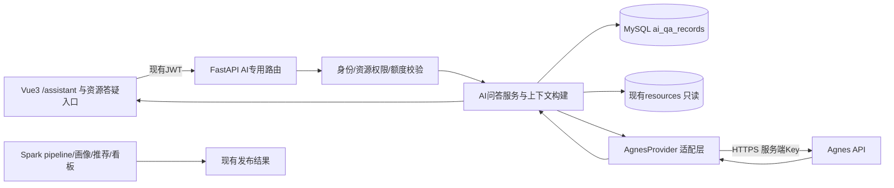

# AI学习助手扩展模块设计

版本：P2设计V1.0；日期：2026-10-05。状态：设计评审稿，等待用户确认；本阶段无代码、安装、迁移或真实模型调用。

## 1. 目标、范围与现有架构

本模块作为P2增强，不改变已验收MVP与毕业设计主线：学习行为采集→Spark清洗→画像→推荐→实验→可视化。AI只辅助解释知识，不替代推荐算法、不评价学习能力、不代表Spark训练大模型。

已核对system-final-architecture.md、backend-architecture.md、frontend-architecture.md、database-design.md、main.py及真实账号联调报告。当前实际数据库七表，daily_metrics为Parquet统计产物；不能把早期规划中23表视为现有实现。

首版范围：登录用户单轮通用学习问答、围绕一条已发布资源的答疑、个人问答历史、失败友好提示。管理员仅可使用自己的助手，不拥有查看全体聊天正文的特权。延后多轮对话、流式输出、全库检索RAG、文件上传、知识库、聊天管理后台、工具调用、模型自动执行代码。删除本扩展中的能力评分、自动修改学习状态、自动运行Spark和生成新推荐算法。

## 2. 模块架构与隔离

Spark与AI没有运行时依赖边：问答不启动Spark、不写learning_events、不加入现有五表抽取投影，不把聊天正文放入ODS/DWD。首版不向模型发送用户画像或推荐批次；以后若设计学习建议，必须另行评审数据用途和批次来源。

配置AI_ASSISTANT_ENABLED默认false。关闭时隐藏菜单，AI接口返回功能不可用；关闭状态不要求API Key、新表或外网可用，现有FastAPI必须仍能启动。开启时只做AI配置局部校验，不在全应用lifespan发模型探测；异常仅使AI功能不可用。

拟新增文件职责（仅设计、未创建）：api/ai_assistant.py、schemas/ai_assistant.py、services/ai_assistant.py、core/ai_config.py、services/providers/agnes.py、models/ai_qa.py；前端views/AiAssistantView.vue、api/assistant.ts、types/assistant.ts。沿用现有目录和JWT，不引入新的微服务、Redis或队列。

外部HTTP采用独立异步客户端与超时；同步SQLAlchemy数据库步骤在工作线程内使用独立短会话，不在事件循环执行阻塞查询，不跨线程共享Session。AI并发槽与连接池独立，避免耗尽MVP资源。

## 3. 数据流与请求生命周期

1. 用户打开登录保护的/assistant；通用模式输入问题；资源模式由详情页入口附resource_id。首次发送前说明问题和所选正文片段会交由Agnes处理，明确提供发送操作，不自动发送页面内容。
2. 前端为一次发送生成request_uuid；只提交question、mode、resource_id、consent_version，不允许提交user_id、角色、system提示词、供应商地址或模型名。
3. FastAPI从JWT读取当前身份，检查active、功能开关、输入长度、用户额度、全局并发和外发确认。资源模式重新检查published，管理员也不能通过助手外发草稿/下架正文。
4. 对request_uuid进行语义指纹与用户隔离校验，短事务记录pending并预留额度。事务提交后才能调用供应商，不持有MySQL事务等待外网。
5. 服务端组合固定学习助手提示、用户问题、当前资源标题和受限片段。外部正文始终是资料，不当成指令。只使用本站许可允许外发的内容，不抓取content_url，不打开任意URL。
6. 调用Agnes；只消费assistant的文本回答，拒绝tool_calls或空正文，不展示内部推理字段。检查输出大小与引用，资源引用由服务端绑定，不接受模型编造任意ID/URL。
7. 短事务发布succeeded或failed，返回request_uuid、answer、实际模型、生成时间、来源/资源版本、免责声明。DB发布失败或进程中断时保留pending，恢复为unknown；不假装调用失败就一定没有计费。
8. 页面显示回答/失败状态，个人历史只查当前用户。资源问答的答案明确标“基于资源片段，未覆盖全部正文”；通用答案标“无本站资源依据”。

未知完成状态、网络超时和客户端断开不得自动再次请求模型。首版前端关闭AI POST自动重试；服务器不自动重试。用户主动重新提问需新UUID，提示可能产生额外消耗。相同请求正在处理返回202，可查询状态；成功返回原记录；失败返回原失败结果；不同语义复用UUID返回409；其他用户UUID返回404。

外部处理不能与MySQL实现分布式原子事务，不宣称供应商端严格exactly-once。崩溃后unknown需要用户确认再新建请求，避免静默重复计费。

## 4. 数据库增量设计

纯即时单轮问答技术上不需要新表；但首版需要个人历史、幂等回执、调用状态与额度审计，建议确认后仅新增一张ai_qa_records。使用“一次问题+一次回答”结构，暂不创建conversation/messages/feedback等多表。无需修改现有七表。

|字段|类型|可空/默认|用途|
|---|---|---|---|
|id|BIGINT UNSIGNED|否，自增|主键|
|request_uuid|CHAR(36) ascii_bin|否，无|服务端规范化小写UUID，唯一|
|user_id|BIGINT UNSIGNED|否，无|当前用户，FK users.id|
|mode|VARCHAR(20)|否，无|general/resource|
|resource_id|BIGINT UNSIGNED|是，NULL|FK resources.id；通用模式为空|
|resource_version|INT UNSIGNED|是，NULL|资源模式绑定本次正文版本|
|request_fingerprint|CHAR(64) ascii_bin|否，无|规范化问题、模式、资源ID及同意版本SHA256，不含凭据|
|question|TEXT|否，无|问题正文，应用限2000字符|
|answer|MEDIUMTEXT|是，NULL|成功答案，应用限16000字符|
|status|VARCHAR(20)|否，pending|pending/succeeded/failed/unknown|
|provider|VARCHAR(30)|否，无|agnes；服务端固定|
|model|VARCHAR(100)|否，无|实际请求的配置模型，不能前端控制|
|prompt_version|VARCHAR(30)|否，无|如learning-assistant-v1，用于解释行为|
|consent_version|VARCHAR(30)|否，无|此次外发提示确认版本|
|provider_request_id|VARCHAR(200)|是，NULL|供应商响应ID；未提供不伪造|
|input_tokens|INT UNSIGNED|是，NULL|仅供应商返回有效usage才记录|
|output_tokens|INT UNSIGNED|是，NULL|缺失不能填0冒充已知|
|latency_ms|INT UNSIGNED|是，NULL|服务端外部调用计时|
|error_code|VARCHAR(50)|是，NULL|内部白名单错误码，不保存原始响应|
|created_at|DATETIME(3)|否，无|UTC服务端受理时间|
|finished_at|DATETIME(3)|是，NULL|最终处理时间|

主键id；唯一uk_ai_qa_request_uuid(request_uuid)；索引(user_id,created_at,id)用于个人历史/额度；(status,created_at)用于pending恢复。FK使用RESTRICT；字符集utf8mb4，UUID/指纹ASCII精确比较。mode与resource_id/version关联约束、status值域和成功答案非空由应用校验并设计适用CHECK。通用与资源版本字段需与现有resources实际DDL最终核对，不盲目假定SQL类型。

服务端保存资源版本及受限来源元信息，不保存完整prompt、正文拷贝或原始供应商请求。历史查看时资源已下架，应遮蔽原答案与资源关联内容并显示不可用，防止历史绕过权限；通用个人记录正常读取。个人记录保留30天，规划专用维护清理；删除仅限AI记录，不级联资源/用户。问答不进入Spark和原推荐评估。

未来实施新增迁移预计004_create_ai_qa_records.sql，必须实施前检查最新迁移号、确认设计与备份；本阶段不生成SQL。上线先迁移再开开关；回退先关开关撤菜单，保留AI记录及表，不自动DROP。

## 5. 拟定API契约

|接口|用途|主要边界|
|---|---|---|
|GET /api/ai/capabilities|登录后查询开关、长度限制、外发说明版本|不返回密钥或内部供应商URL|
|POST /api/ai/questions|创建单轮问答|JWT；request_uuid/question/mode/resource_id/consent_version|
|GET /api/ai/questions/{request_uuid}|查看自己的处理状态/答案|其他用户404；pending202|
|GET /api/ai/history|个人历史分页|用户从JWT确定；不接受任意user_id|

400/422输入不合规；401沿用现有清理登录状态；404资源或记录不可用；409UUID冲突；429额度/并发超限；502供应商异常；503模块关闭、配置或AI数据库不可用；504超时。响应统一公共文案，不透传Authorization、原始异常或供应商HTML。首版不新增管理员读聊天接口。

## 6. Agnes API接入方案与核验边界

本设计暂按Agnes AI国际站理解，用户尚未确认具体服务或控制台；若实际为其他Agnes服务，替换供应商适配层，不改变页面与内部契约。

2026-10-05已查阅[官方文档索引](https://wiki.agnes-ai.com/llms.txt)与[AgnesAI-Labs FAQ](https://github.com/AgnesAI-Labs/AgnesAI-Models/blob/main/docs/FAQ.md)。FAQ说明兼容Chat Completions，base为https://apihub.agnes-ai.com/v1，POST /v1/chat/completions。官方索引列出2.5 Flash/Pro等模型；不据此保证用户账号有调用权限。部分指南及隐私正文未能读取，未验证数据保留或训练使用条款。

接入首选单一文本模型，版本稳定且账号可用再定。agnes-2.5-flash仅为候选，不直接锁定已验证模型；不以宣传免费作为成本保障。实施先在控制台确认账号模型、限流、费用、保留政策，再用不含私密内容的最小请求验证鉴权、assistant文本、usage和错误响应。本阶段未访问控制台、未提交请求、未安装SDK。

FastAPI供应商适配层以HTTP JSON接入，设计采用Authorization Bearer，具体Header与字段必须依据实施时官方Quickstart/真实回执核对；messages用固定system+user，非流式stream=false、限制max_tokens，不启用tools。兼容协议不等于完全兼容SDK；首版不引入LangChain。

|后端配置|设计值/约束|
|---|---|
|AI_ASSISTANT_ENABLED|false默认|
|AGNES_BASE_URL|用户确认后固定HTTPS供应商域名，不允许请求参数覆盖|
|AGNES_API_KEY|只在服务端安全存储/进程环境读取|
|AGNES_MODEL|经最小验证的允许列表单模型|
|AI_CONNECT_TIMEOUT_SECONDS|5秒|
|AI_TOTAL_TIMEOUT_SECONDS|45秒总deadline；前端60秒|
|AI_MAX_OUTPUT_TOKENS|1024起步，协议实测后调整|
|AI_USER_DAILY_REQUEST_LIMIT|20次已受理请求/UTC日，失败也占额度|
|AI_GLOBAL_DAILY_REQUEST_LIMIT|100次已受理请求/UTC日|
|AI_MAX_CONCURRENT_REQUESTS|2，超出拒绝，不无限排队|

以上是本项目保护阈值，不是Agnes的官方额度或保证。成本按实际usage与当期价格记录；usage缺失保留未知，不能估算成真实账单。若价格未确认，不启用付费模型。单实例锁保护额度预留和数据库计数；本机单worker验收。未来多worker需数据库锁或共享限流方案另行设计，不能将进程Semaphore称为全局锁。

## 7. 前端页面设计

新增登录保护/assistant，导航仅开关启用时显示。三部分：模式与资源来源栏、问题与回答主区、个人历史区；适配窄窗口纵向排布。资源详情“向AI提问”只跳转并带resource_id，不自动外发、不额外产生学习动作。

问题区显示字符剩余、外发说明、发送按钮；提交中禁用重复发送并显示等待。答案显示模型、生成时间、AI生成提示、资源版本和可见来源；资源片段不足时明确建议查看原文，不假装完成全资源检索。失败保留本地输入，给公共错误和是否可重新提问，不渲染原始错误。

首版纯文本渲染，保留换行；不使用v-html。代码示例仅展示不执行。状态包括关闭/未登录/无历史/发送中/成功/失败/unknown/资源下架。刷新后历史从本人接口恢复；问题正文不写localStorage，退出清空内存，不向第三方分析脚本发送。

## 8. 安全与数据最小化

复用JWT/current_user、active检查与现有角色，不建立复杂权限系统。身份隔离由服务端保证；前端守卫只是体验。密钥不出现在VITE_*、URL、代码、Git、截图或日志；日志只含内部request_uuid、状态、耗时，不记录问答正文、JWT、外部Header或完整响应。

外发仅问题及用户选定、许可允许的资源片段；不发账号名、邮箱、密码哈希、JWT、行为流水、数据库连接信息或个人画像。问题自身可能包含个人信息，提交前明示，服务端执行明确格式敏感值阻断/脱敏，但不能承诺自动识别全部隐私。

上下文上限：问题2000字符、标题200字符、资源正文片段6000字符；截断应提示。资源内容可能带提示注入，固定指令要求只当资料，且完全不授予数据库、文件、网络工具访问和写权限，提示词规则不是安全隔离的唯一依据。供应商Host固定、HTTPS校验开启、不跟随跨域重定向；禁止模型输出触发请求或执行SQL/Shell。

个人历史不供管理员批量阅读；回答不作为权威答案或能力评价。数据保留、模型训练用途、跨境处理情况仍待核对供应商政策。授权不清的资源正文仅提供标题/摘要或拒绝资源模式；为答辩优先使用本项目自编演示材料。

## 9. 实施计划、测试与阶段门禁

建议总投入32–44小时，约2–3周每天2–4小时，包含缓冲；不得占用论文和主链路验收关键时间。

|子阶段|预计投入|完成标准|
|---|---|---|
|A 服务与范围确认|4小时|确认具体Agnes服务、模型、费用、外发政策及本设计；无私密最小调用成功|
|B 后端与单表实施|10–14小时|先迁移再启用；问答、幂等、个人权限、失败边界与成本限制验证|
|C Vue问答页|6–8小时|通用/资源模式、历史、所有异常状态；真实账号联调|
|D 回归与交付|8–10小时|AI关闭及供应商故障时MVP正常；正式页面与真实API证据，不靠mock证明真实接入|
|缓冲|4–8小时|供应商协议差异和限流排查；超期关闭扩展保留MVP|

每个实施子阶段先文档后实现，产出设计更新和独立验收报告，等待用户确认后再推进。当前只完成设计，不自动进入A的调用测试。后续最少覆盖：匿名401、停用账号拒绝、本人历史隔离、管理员不可看他人、已发布上下文、下架遮蔽、UUID重放/冲突/pending、并发与额度、Key缺失、401/429/5xx/超时、空回答与tool_calls拒绝、危险HTML纯文本、敏感日志检查、开关关闭启动与既有认证/资源/学习/推荐/看板回归。

真实模型质量用20条固定学习问题及5条自编资源题，由人工检查事实、相关性、来源忠实度、无依据时是否说明，记录模型/提示版本和耗时。模拟响应只证明异常处理；真实调用另存脱敏回执。没有测试前不报告成功率或提升。

停止条件：供应商身份/隐私/费用无法确认，无法完成最小调用，出现MVP回归或预估投入超过44小时，默认关闭P2，优先毕业设计交付。
