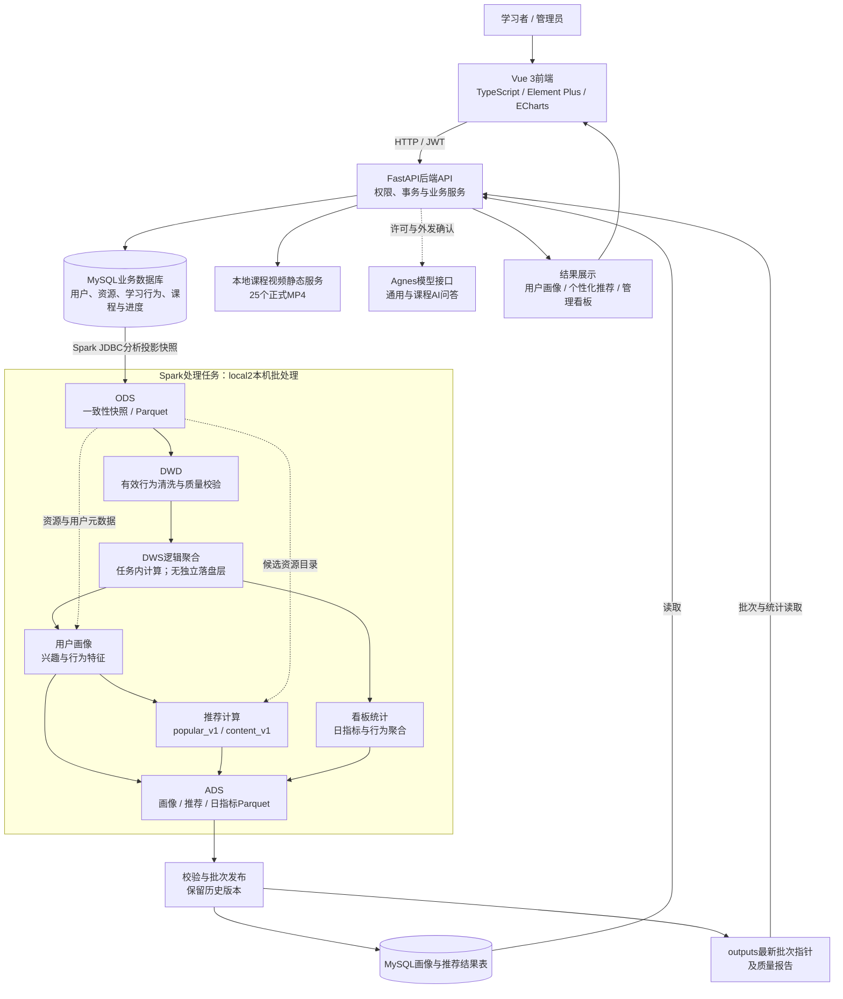

# 项目系统架构

日期：2026-10-11。依据当前源码与配置整理；本轮仅文档及服务启动检查，没有执行Spark任务或数据库迁移。

## 总体架构

[Draw.io可编辑源文件](architecture.drawio)可通过diagrams.net的“文件→打开→从设备”导入。图中的MySQL业务库与结果表属于同一MySQL部署，拆分节点仅表示职责。

## 分层与实际实现

| 层次 | 实现与来源 |
|---|---|
| ODS | spark/jobs/extract.py：users、resources、learning_progress、favorites、learning_events分析投影快照 |
| DWD | spark/jobs/clean.py、quality.py：有效行为清洗、质量核验 |
| DWS逻辑层 | 聚合在spark/utils及画像、推荐、看板任务中完成；没有data/dws目录或独立DWS发布任务 |
| ADS | data/ads/user_profiles、recommendations、daily_metrics下的批次Parquet |
| 画像 | spark/jobs/user_profiles.py；校验后发布MySQL user_profiles |
| 推荐 | spark/jobs/recommendations.py；热度基线与融合标签/行为/热度，发布recommendation_results |
| 看板 | spark/jobs/dashboard_metrics.py；日指标Parquet及配套批次信息 |
| 编排与实验 | pipeline.py编排抽取/清洗/质量；recommendation_experiment.py独立离线评价，不自动发布线上 |

实际存储链路为ODS→DWD→ADS。DWS在图中是理解聚合职责的逻辑标注，不代表新增了分层任务、目录或数据库表。

## 在线业务与离线边界

- frontend/src/router/index.ts定义登录、首页、资源、章节学习、推荐与管理看板；画像在推荐页展示。
- backend/app/main.py注册用户、资源、学习行为、课程、推荐、看板、管理员和AI接口，并挂载/videos。
- MySQL采用database/migrations/001–007 SQL迁移；章节行为并非全部直接进入五表分析，只有既有桥接规则生成的主学习事件进入链路。
- Spark参数来自spark/configs/pipeline.json，当前master为local[2]；使用本地Parquet，没有部署HDFS或集群调度器。
- 前端刷新读取已发布结果，不触发Spark；画像及推荐通过MySQL结果表展示，看板结合已发布文件及当前数据库部分信息。
- AI是可选外部模型能力，受认证、许可、确认和额度控制；没有向量数据库或自动学习进度更新。
- 视频文件位于frontend/public/videos，绑定通过现有课程字段与目录规则识别，本轮不修改绑定或视频。

## 运行与验证边界

当前服务通过原有脚本启动；登录页面已实际查看，后端OpenAPI与前端首页的HTTP检查见本轮交付说明。此架构文档不替代全系统验收。测试、正式发布与最新视频证据见根README链接；密钥、私有配置、原片备份、候选、数据文件不随展示文档公开。
