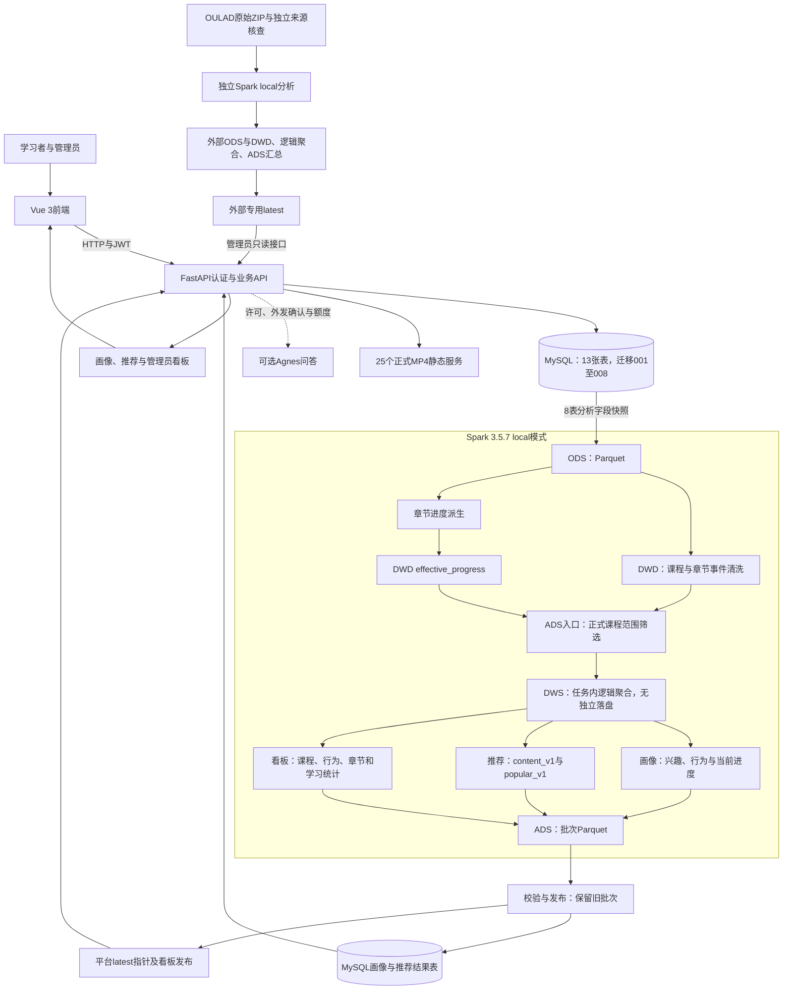
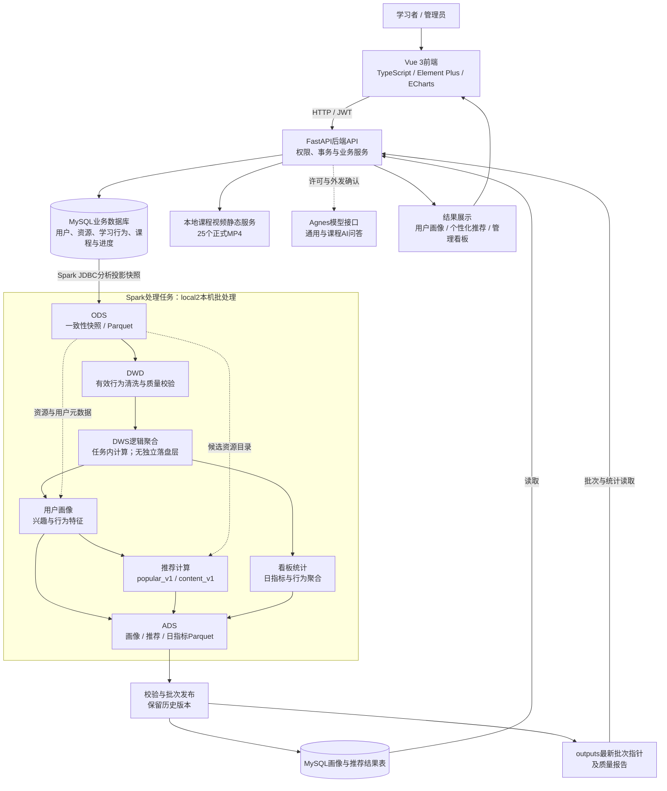

# 项目系统架构

更新日期：2026-10-24；已验收已推送代码基线c0e2ca6f390c443f4e61b9512a5cfbba81806136。本轮只同步文档，未运行Spark或修改数据库。完整批次和统计定义见[当前状态](defense-current-state.md)。

## 当前总体架构

[Draw.io可编辑架构图](architecture.drawio)与上图采用相同职责划分。MySQL业务表和分析结果表位于同一部署；外部数据分支不向平台注册用户或学习事件中灌入数据。

## 当前数据结构与分层

| 层/职责 | 实际实现 |
|---|---|
| MySQL13表 | 核心5表、章节3表、分析结果2表、AI辅助2表、认证恢复码1表 |
| ODS8表 | users、resources、learning_progress、favorites、learning_events、course_chapters、chapter_progress、chapter_events；分析字段投影，不导出凭据 |
| DWD | clean.py/quality.py清洗课程与章节事件，保留过滤记录，生成effective_progress |
| DWS逻辑职责 | 画像、推荐及看板任务内部关联与聚合，无独立物理层 |
| ADS | 批次画像、推荐、daily_metrics Parquet；结果表与发布指针按批次配对 |
| 外部数据 | audit_oulad_source.py与oulad_analysis.py；独立七CSV、目录和专用发布，不与平台8表混合 |
| 认证辅助表 | 008 auth_recovery_codes；不属于Spark画像输入，部署时显式迁移 |

## 正式课程和进度一致性

正式课程为已发布、含章节、非验收且未隐藏，当前5门25章。原始资源和旧批次不删除；正式范围只用于当前学习者展示及分析入口。推荐在TopN前筛选，展示再核验当前状态。原resource_type保留，用display_type派生课程标签。

章节课程以章节记录派生当前状态，所有章节完成才算课程完成；历史资源completed及完成事件仍保留为历史，不补造完成数据。章节浏览/播放独立参与画像、推荐及看板，首次开始/整课完成的课程级桥接仍存在，不能把桥接事件当成全部章节数据。观看位置不等于观看时长。

## 当前发布与数字范围

源20261024T054843Z_de437452；配套画像、推荐与看板完整ID见[状态表](defense-current-state.md#当前配套批次)。截止2026-10-24 05:48:44.421 UTC。课程事件141→140，过滤1；正式课程有效行为99，画像4份、推荐40行（每算法20）。当前正式课程开始5条用户课程关系、完成0条；章节浏览108、播放156、章节完成2。

新范围看板课程总数、分类及学习统计均来自同一冻结快照，不与实时目录拼接。在线课程状态和推荐可见性仍读取当前记录；后续操作或下架产生的差异需下一批次更新，不称为实时分析。旧批次兼容逻辑保留其原统计语义，不追写历史。

## 验收与部署边界

认证隔离12项测试与双端真实页面已完成冻结前验收；本轮是文档同步，不重跑。25视频摘要一致，既有验收25通过。本地链接、XML和保护摘要核验结果见当前状态说明。管理员写操作、真实学生研究、推荐效果提升、生产安全和集群性能不由这些检查证明。数据和运行附件被忽略，移机不能只克隆源码就视为恢复成功。

## 历史架构记录

2026-10-11/13原架构文档，保留当时五表及旧迁移边界

# 项目系统架构

> 当前口径补注（2026-10-13）：正文中的冻结版本与旧批次是历史依据；当前代码基线为b8474f2，最新Spark源批次为20261013T052412Z_1fc73f17。 当前技术栈、视频播放证据和各数据口径统一见[答辩当前状态说明](defense-current-state.md)；本次仅修订文档，没有重新验收或运行Spark。

日期：2026-10-11。依据当前源码与配置整理；本轮仅文档及服务启动检查，没有执行Spark任务或数据库迁移。

## 总体架构

[Draw.io可编辑源文件](architecture.drawio)可通过diagrams.net的“文件→打开→从设备”导入。图中的MySQL业务库与结果表属于同一MySQL部署，拆分节点仅表示职责。

## 分层与实际实现

| 层次 | 实现与来源 |
|---|---|
| ODS | spark/jobs/extract.py：users、resources、learning_progress、favorites、learning_events分析投影快照 |
| DWD | spark/jobs/clean.py、quality.py：有效行为清洗、质量核验 |
| DWS逻辑层 | 聚合在spark/utils及画像、推荐、看板任务中完成；没有data/dws目录或独立DWS发布任务 |
| ADS | data/ads/user_profiles、recommendations、daily_metrics下的批次Parquet |
| 画像 | spark/jobs/user_profiles.py；校验后发布MySQL user_profiles |
| 推荐 | spark/jobs/recommendations.py；热度基线与融合标签/行为/热度，发布recommendation_results |
| 看板 | spark/jobs/dashboard_metrics.py；日指标Parquet及配套批次信息 |
| 编排与实验 | pipeline.py编排抽取/清洗/质量；recommendation_experiment.py独立离线评价，不自动发布线上 |

实际存储链路为ODS→DWD→ADS。DWS在图中是理解聚合职责的逻辑标注，不代表新增了分层任务、目录或数据库表。

## 在线业务与离线边界

- frontend/src/router/index.ts定义登录、首页、资源、章节学习、推荐与管理看板；画像在推荐页展示。
- backend/app/main.py注册用户、资源、学习行为、课程、推荐、看板、管理员和AI接口，并挂载/videos。
- MySQL采用database/migrations/001–007 SQL迁移；章节行为并非全部直接进入五表分析，只有既有桥接规则生成的主学习事件进入链路。
- Spark参数来自spark/configs/pipeline.json，当前master为local[2]；使用本地Parquet，没有部署HDFS或集群调度器。
- 前端刷新读取已发布结果，不触发Spark；画像及推荐通过MySQL结果表展示，看板结合已发布文件及当前数据库部分信息。
- AI是可选外部模型能力，受认证、许可、确认和额度控制；没有向量数据库或自动学习进度更新。
- 视频文件位于frontend/public/videos，绑定通过现有课程字段与目录规则识别，本轮不修改绑定或视频。

## 运行与验证边界

当前服务通过原有脚本启动；登录页面已实际查看，后端OpenAPI与前端首页的HTTP检查见本轮交付说明。此架构文档不替代全系统验收。测试、正式发布与最新视频证据见根README链接；密钥、私有配置、原片备份、候选、数据文件不随展示文档公开。

