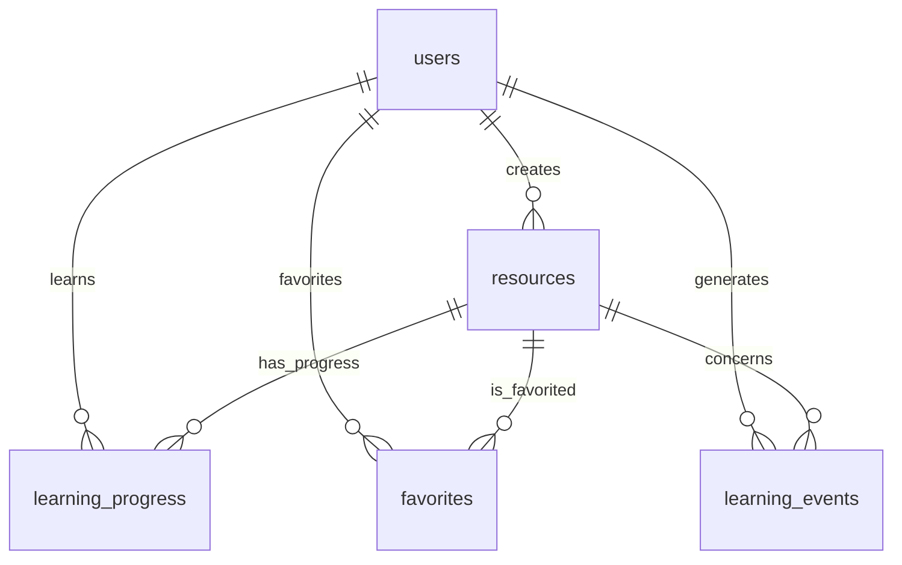

# 第一版数据库与学习行为数据模型设计

项目：基于 Spark 的学习行为分析与个性化资源推荐系统设计与实现  
版本：V1.0；日期：2026-10-04；状态：设计基线，尚未建表或执行验证

## 1. 范围与设计结论

第一阶段保留五张业务核心表：users、resources、learning_progress、favorites、learning_events。范围合理，能够支持身份与兴趣、资源元数据、学习状态、当前收藏及可追溯行为，暂不增加关系字典表、请求回执表或分析结果表。

本设计细化已确认MVP，不生成SQL、ORM模型或迁移。后续Spark阶段再设计并创建analysis_batches、user_profiles、recommendation_results、daily_metrics、serving_versions；本阶段不将它们计为已完成。

相对概览的必要细化：学习进度无记录表示未开始；事件新增有效性、状态前后值、来源和请求指纹，用同一事件表保存有效行为及无状态变化操作的幂等回执。后者不是有效学习证据，分析时必须排除。

## 2. 通用约定

- MySQL 8.0.45兼容设计，InnoDB，表字符集utf8mb4，通用文本排序规则utf8mb4_unicode_ci。
- 所有关联ID统一BIGINT UNSIGNED。UUID、指纹与固定代码使用ASCII精确比较；UUID规范化为小写，字段采用ascii_bin，避免大小写/重音排序规则影响标识。
- 主键ID由数据库自增；复合主键表不再增加无用途的自增ID。MySQL自增值不等于提交顺序或严格事件时间。
- 时间为DATETIME(3)，由服务端以UTC写入，数据库连接时区约定UTC。页面与业务日统计转换为Asia/Shanghai。
- 字段表中“无”表示无默认值，插入时必须明确提供；“NULL”表示可空默认NULL。应用写入时间，不依赖客户端时钟或未明确时区的数据库默认时间。
- 状态和事件类型使用VARCHAR加值域约束，避免首版ENUM变更成本。跨表、跨行规则由服务端事务承担；不把CHECK当成跨表校验。
- JSON字段无数据库默认值，应用明确写入空数组或规范内容。数据库保证JSON语法，应用检查结构、类型、数量、重复项及受控标签值。
- 用户和资源采用状态停用/下架/软删除，不物理级联删除历史。全部外键删除/更新策略为RESTRICT；关联键不可修改。
- 所列为设计索引，不代表已创建或已完成执行计划验证。后续迁移与真实查询验证后才确定性能结论。

MySQL 8.0支持JSON并校验其语法，JSON不是普通标量索引列；本设计不直接给标签数组建立普通索引。[MySQL JSON说明](https://dev.mysql.com/doc/refman/8.0/en/json.html)

本机版本具备CHECK约束执行能力，后续可用于值域及本行一致性；服务端仍负责跨表业务规则。[MySQL CHECK说明](https://dev.mysql.com/doc/refman/8.0/en/create-table-check-constraints.html)

## 3. users：用户与显式兴趣

用途：账号、角色、账号状态和受控兴趣标签。没有测验信息，不保存“能力分数”。

| 字段 | 数据类型 | 可空 | 默认值 | 说明 |
|---|---|---|---|---|
| id | BIGINT UNSIGNED | 否 | 自增 | 用户主键 |
| username | VARCHAR(50) | 否 | 无 | 登录名；ASCII规范化小写，允许字符和长度由服务端校验，ascii_bin比较 |
| password_hash | VARCHAR(255) | 否 | 无 | 安全密码哈希及算法参数，不是明文或可逆加密密码 |
| nickname | VARCHAR(50) | 是 | NULL | 展示名称，不用于鉴权 |
| role | VARCHAR(20) | 否 | learner | learner/admin；普通注册只能获得learner |
| status | VARCHAR(20) | 否 | active | active/disabled/deleted |
| interest_tags | JSON | 否 | 无 | 去重的受控标签编码数组；无兴趣由应用写入空数组 |
| created_at | DATETIME(3) | 否 | 无 | 服务端UTC创建时间 |
| updated_at | DATETIME(3) | 否 | 无 | 服务端UTC最后修改时间 |

主键：id。外键：无。

索引：唯一索引uk_users_username(username)；管理列表索引idx_users_status_role_id(status,role,id)。按ID查用户使用主键。

约束：username不允许仅空白，规范化后唯一；role/status在允许值内；updated_at不早于created_at；interest_tags只含字典内字符串，不允许任意文本或嵌套对象。用户ID来自登录身份，不接受客户端指定其他用户。

## 4. resources：学习资源

用途：可独立学习的资源单元、分类标签和发布状态。文本/文档说明/外链为首版内容，不扩展章节与视频转码。

| 字段 | 数据类型 | 可空 | 默认值 | 说明 |
|---|---|---|---|---|
| id | BIGINT UNSIGNED | 否 | 自增 | 资源主键 |
| title | VARCHAR(200) | 否 | 无 | 非空标题 |
| resource_type | VARCHAR(20) | 否 | 无 | document/course/exercise；仅资源形式，不意味着完整课程体系 |
| category_code | VARCHAR(40) | 否 | 无 | 固定分类编码，ASCII精确比较 |
| tags | JSON | 否 | 无 | 受控标签编码数组；草稿可为空数组，发布要求至少一个有效标签 |
| difficulty | TINYINT UNSIGNED | 否 | 1 | 1基础/2中等/3进阶；仅资源属性，不是用户能力判断 |
| summary | VARCHAR(1000) | 否 | 无 | 非空内容简介 |
| content | LONGTEXT | 是 | NULL | 自编或许可允许的正文，应用限制提交大小 |
| content_url | VARCHAR(1000) | 是 | NULL | HTTP/HTTPS外部内容地址；不存秘密或本机私有路径 |
| source_name | VARCHAR(255) | 是 | NULL | 来源名称 |
| license_note | VARCHAR(500) | 是 | NULL | 许可或使用范围说明 |
| status | VARCHAR(20) | 否 | draft | draft/published/offline/deleted |
| version_no | INT UNSIGNED | 否 | 1 | 标签、分类、难度、内容或发布状态变化时递增 |
| created_by | BIGINT UNSIGNED | 否 | 无 | 创建管理员的用户ID |
| published_at | DATETIME(3) | 是 | NULL | 首次发布时间；再次上架不覆盖首次时间 |
| created_at | DATETIME(3) | 否 | 无 | 服务端UTC创建时间 |
| updated_at | DATETIME(3) | 否 | 无 | 服务端UTC修改时间 |

主键：id。外键：created_by → users.id；外键仅保证用户存在，admin角色须服务端验证。

索引：idx_resources_status_category_id(status,category_code,id)用于分类列表；idx_resources_status_id(status,id)用于无分类分页；idx_resources_updated_id(updated_at,id)用于变更审查；idx_resources_created_by(created_by)支持外键及管理查询。

首版标题包含搜索不宣称上述普通索引能够加速；资源量小时接受扫描，暂不建全文检索系统。JSON标签筛选在小规模下处理，性能不足时再评估生成列或关系表。

约束：difficulty为1—3，version_no至少1；发布需要非空正文或可用内容地址、有效分类和至少一个标签；published状态必须有published_at。资源下架后禁止新的开始/完成/收藏，允许用户移除已有收藏；浏览采集只接受详情仍可访问的已发布资源。

## 5. learning_progress：当前学习状态

用途：每用户每资源的一条当前进度。无记录表示not_started，数据库只存in_progress/completed，避免预填全部用户资源组合。

| 字段 | 数据类型 | 可空 | 默认值 | 说明 |
|---|---|---|---|---|
| user_id | BIGINT UNSIGNED | 否 | 无 | 用户ID |
| resource_id | BIGINT UNSIGNED | 否 | 无 | 资源ID |
| status | VARCHAR(20) | 否 | in_progress | in_progress/completed |
| first_started_at | DATETIME(3) | 否 | 无 | 首次开始时间；再次开始不覆盖 |
| completed_at | DATETIME(3) | 是 | NULL | 首次成功标记完成时间 |
| updated_at | DATETIME(3) | 否 | 无 | 最后真实状态变化时间；无变化重试不修改 |

主键：(user_id,resource_id)。外键：user_id → users.id，resource_id → resources.id。

索引：idx_progress_user_status_updated(user_id,status,updated_at,resource_id)用于个人进度；idx_progress_resource_user(resource_id,user_id)支持资源侧查询与外键；主键覆盖用户资源精确查找。

本行约束：completed必须有completed_at；in_progress的completed_at必须为空；完成时间不早于首次开始；updated_at不早于first_started_at。跨表状态变更与对应事件同事务。

状态规则：未开始只能先开始，不能直接完成；in_progress可完成；已完成不可重置为未开始。重复开始/完成不产生有效新行为，也不刷新首次时间。外链完成仅证明用户手动标记，不证明外站实际学完。

## 6. favorites：当前有效收藏

用途：存储当前仍存在的收藏关系，取消时删除该关系；历史变化保留在learning_events。

| 字段 | 数据类型 | 可空 | 默认值 | 说明 |
|---|---|---|---|---|
| user_id | BIGINT UNSIGNED | 否 | 无 | 用户ID |
| resource_id | BIGINT UNSIGNED | 否 | 无 | 资源ID |
| created_at | DATETIME(3) | 否 | 无 | 本次收藏关系建立时间；取消后重新收藏使用新时间 |

主键：(user_id,resource_id)。外键：user_id → users.id，resource_id → resources.id。

索引：idx_favorites_user_created(user_id,created_at,resource_id)用于个人收藏列表；idx_favorites_resource_user(resource_id,user_id)支持资源侧统计和外键。

约束：同一组合只能有一条；重复收藏不刷新created_at；取消不存在的收藏为无状态变化成功回执。禁止用当前表计算任意历史截止时刻的收藏状态。

## 7. learning_events：行为事实与幂等回执

用途：记录被服务端接受的五类行为请求，保存有效行为与无状态变化回执。其核心字段不可由客户端自由修改，记录写入后不通过业务接口修改或删除。

| 字段 | 数据类型 | 可空 | 默认值 | 说明 |
|---|---|---|---|---|
| id | BIGINT UNSIGNED | 否 | 自增 | 内部事件编号，同用户同资源时间相同情况下辅助排序 |
| event_uuid | CHAR(36) | 否 | 无 | 规范化小写UUIDv4，ascii_bin；全局唯一的请求/事件幂等标识 |
| user_id | BIGINT UNSIGNED | 否 | 无 | 从已认证身份获取 |
| resource_id | BIGINT UNSIGNED | 否 | 无 | 所有首版事件均必须关联资源 |
| event_type | VARCHAR(32) | 否 | 无 | 五种固定编码，ASCII精确比较 |
| event_source | VARCHAR(16) | 否 | 无 | client/server，由服务端按事件类型确定 |
| schema_version | SMALLINT UNSIGNED | 否 | 1 | 事件结构版本 |
| resource_version | INT UNSIGNED | 否 | 无 | 接受事件时服务端读取的资源版本，仅用于追溯，不代替元数据快照 |
| session_id | CHAR(36) | 是 | NULL | 客户端访问会话UUID，非Cookie/令牌；浏览必填，业务操作可选 |
| occurred_at | DATETIME(3) | 否 | 无 | 服务端接受并确定本次行为顺序的UTC时间，权威分析时间 |
| received_at | DATETIME(3) | 否 | 无 | 请求到达服务端的UTC时间；重试不覆盖原记录 |
| client_occurred_at | DATETIME(3) | 是 | NULL | 浏览可提供的UTC客户端时间，仅诊断，不驱动排序或统计 |
| is_effective | TINYINT UNSIGNED | 否 | 无 | 1有效行为，0无状态变化回执；由服务端确定 |
| state_before | VARCHAR(20) | 是 | NULL | 业务操作前状态；浏览为空 |
| state_after | VARCHAR(20) | 是 | NULL | 业务操作后状态；浏览为空 |
| request_fingerprint | CHAR(64) | 否 | 无 | 规范化业务语义的SHA-256十六进制摘要，ascii_bin；用于相同UUID内容冲突判断 |

主键：id。外键：user_id → users.id，resource_id → resources.id；RESTRICT防止级联抹除事实。索引由后续迁移明确建立，避免依赖自动生成的冗余外键索引。[MySQL外键说明](https://dev.mysql.com/doc/refman/8.0/en/create-table-foreign-keys.html)

索引：

| 名称 | 字段顺序 | 用途 |
|---|---|---|
| uk_events_uuid | event_uuid，唯一 | 重试回执、冲突处理的最终数据库保障 |
| idx_events_user_resource_time | user_id,resource_id,occurred_at,id | 用户资源状态重构、行为核对 |
| idx_events_user_time | user_id,occurred_at,id | 用户近7/30天行为 |
| idx_events_resource_time | resource_id,occurred_at,id | 资源趋势与热度输入 |
| idx_events_received_id | received_at,id | 收到时间范围抽取与快照清单 |

不单独索引低基数event_type/is_effective。通过id分批全量抽取使用主键；真实数据与查询计划出来后再决定是否缩减或新增索引。

### 7.1 事件类型与状态语义

| event_type | 来源 | 触发 | 有效状态变化/证据 |
|---|---|---|---|
| resource_view | client | 已发布详情实际可见后提交一次 | 1；before/after均为空，弱兴趣证据 |
| learning_start | server | 开始学习业务请求 | not_started→in_progress为1；in_progress→in_progress或completed→completed为0 |
| learning_complete | server | 已开始资源被手动标记完成 | in_progress→completed为1；completed→completed为0；未开始请求拒绝 |
| favorite_add | server | 收藏业务请求 | not_favorited→favorited为1；favorited→favorited为0 |
| favorite_remove | server | 取消收藏业务请求 | favorited→not_favorited为1；not_favorited→not_favorited为0 |

source=server表示事件语义和状态变化由服务器业务事务决定，用户仍可在前端发起操作；不能让客户端再次单独提交相同业务事件。

拒绝的未登录、越权、非法资源、非法UUID或未开始完成请求不写入此事实表，未来如需诊断只记录去敏错误日志。浏览客户端时间缺失可为空，明显异常不用于分析；服务端权威时间始终保留。

### 7.2 UUID与请求指纹

客户端在一次浏览访问或一次明确业务操作发起前生成UUIDv4。在请求结束前保存该标识；网络超时、重复发送和同一次点击处理沿用它，不重新生成。真正的新操作使用新UUID。后端内部操作也必须在第一次尝试前生成标识，并贯穿重试。

UUID唯一索引只解决相同标识，不会自动判断两个不同UUID是不是同一意图。业务状态检查负责处理重复点击，Spark按统计口径处理多次真实浏览。异常冲突不得当成正常重复成功。

指纹由服务端按固定顺序编码schema_version、user_id、resource_id、event_type后计算；首版语义仅包含这些字段。接收时间、当前资源版本、会话和客户端时间不参与业务语义指纹，重试不会因运行时变化误报冲突。未来如果增加会改变业务结果的参数，须升级结构和指纹规范。

复用UUID但用户、资源或事件类型不同：返回冲突并拒绝写入，不返回其他用户原事件详情。匹配：返回原event_uuid、is_effective、state_after、occurred_at等回执，不重新执行业务；可另返回当前状态用于刷新界面，必须区分原回执和当前状态。

### 7.3 事务、重复提交与并发

首版低并发下采用每用户串行的业务操作锁，保持五表范围并处理“收藏关系不存在时无法锁定现有行”的问题。

1. 完成身份、请求格式与语义校验，计算指纹；对已有匹配回执优先返回，不因资源后来下架而重做成功操作。
2. 进入事务，锁定该用户行，重新检查UUID回执。四类业务操作均遵守此锁顺序；浏览无需业务状态锁。
3. 对新请求检查用户权限和资源可用性；涉及发布状态的业务读锁定资源行并与资源管理遵循一致锁顺序，避免校验后资源状态竞争。
4. 读取当前进度/收藏，执行允许的状态变化。没有变化也形成is_effective=0回执；不刷新业务时间。
5. 服务端生成时间、状态前后值和资源版本，插入事件；与进度/收藏变化一起提交。
6. 任一步失败整体回滚。唯一冲突回滚整个事务后，另行读取已提交回执并比较指纹。死锁/超时允许有界重试，仍使用原UUID。

重放旧请求时必须先读原回执再检查当前状态。例如A请求“取消不存在的收藏”保存0回执，B随后收藏成功，A网络重试只返回旧回执，不能再删除B的收藏。若不保存无变化回执，只依赖当前状态，会产生此错误。

业务新UUID与相同状态只会增加0回执，Spark不计为兴趣或转化。客户端同一操作禁止无限生成UUID；后续需频率限制控制回执量，但不把频率限制代替幂等机制。

### 7.4 时间、顺序与不可变性

received_at在请求入口记录；occurred_at在事务获得业务锁后、决定状态变化时记录，通常不早于received_at；客户端重试不修改原时间。浏览以服务端校验接受时刻为occurred_at。

同用户同资源的有效业务事件按(occurred_at,id)排列；锁住该用户的业务事务保证串行，不能把跨用户id顺序理解为提交顺序。延迟的不同新请求按服务端处理顺序生效，首版不实现离线客户端队列或跨设备意图顺序恢复。

事件不可变不代表永久保留所有个人信息。首版不暴露物理删除接口；正式保留期限与去标识流程后续另行定义，不级联删除历史。不得把密码、Token、Cookie、IP、完整User-Agent或任意客户端对象写入事件。

### 7.5 本行约束与校验归属

- is_effective只允许0/1；schema_version和resource_version至少1；所有枚举编码限制值域。
- resource_view必须source=client、有效性为1、session_id非空、前后状态为空。
- 四类业务事件source=server，前后状态非空，客户端时间为空；有效变化/无变化须符合7.1允许的组合。
- occurred_at不早于received_at。UUID格式、指纹计算、身份、标签字典和跨行事务由服务端校验。
- 浏览刷新或新访问可以产生新UUID，但分析时同用户、同资源、同北京时间自然日只取一次浏览作为兴趣/热度贡献；原始浏览次数与去重统计分别说明。

## 8. ER关系

users与resources通过created_by形成管理员创建关系，不代表学习关系。用户与资源的多对多学习关系由learning_progress承载，多对多收藏关系由favorites承载；learning_events记录同一用户资源组合的多次事件。

learning_events不外键指向favorites或learning_progress：取消收藏后关系行会消失，事件仍应存在；浏览也不一定存在进度。业务一致性通过共同user_id/resource_id、状态前后值、UUID和同一事务保证，不使用循环外键。首版不新增progress_id、favorite_id。

## 9. Spark需求匹配与数据边界

| 需求 | 输入与处理 | 是否支持/限制 |
|---|---|---|
| 兴趣画像 | users.interest_tags、resources.tags、有效事件；标签展开、归一化、行为权重与衰减 | 支持；没有能力与注意力证据 |
| 学习行为统计 | 有效事件、进度；近7/30天活跃日、去重浏览、开始/完成数、收藏状态 | 支持；不支持精确时长、评分或测验表现 |
| 热门推荐 | 去重浏览、有效开始/完成、截止时有效收藏 | 支持；取消收藏不作为正向行为，0回执排除 |
| 内容推荐 | 冻结资源标签/分类向量、显式兴趣、有效行为画像 | 支持；difficulty为资源描述，不伪造用户能力 |
| 冷启动 | 用户显式兴趣与热门资源 | 支持；无兴趣无行为用热门兜底 |
| 历史实验 | 已保存的元数据快照、事件、时间划分与候选规则 | 条件支持；未存快照前的兴趣/资源元数据变更不可完全还原 |

五表是输入模型，不能代替后续画像、推荐、批次和指标结果存储。

### 9.1 快照与历史一致性

后续抽取采用有限规模全量、一致性读取快照：在同一InnoDB一致性快照内读用户、资源、事件及当前状态，保存数据来源、事件/元数据行数、截止时间、接收水位与文件摘要。快照内可见且满足截止条件的事件才进入批次。

不要仅凭“最大自增ID”或received_at推断全部事务已提交。一次快照之后才提交的事务由下一批读取，不能因ID较小永久漏掉；首版不做依赖ID水位的增量CDC。该流程是后续实施要求，本阶段没有执行快照。

历史截止时的收藏必须从截止前有效favorite_add/remove重构；状态表仅用于当前服务和对账。分析窗口开始前的历史收藏状态不能丢失。仅把窗口内取消数从收藏数相减不能恢复正确状态。

resources.version_no和事件resource_version只标识版本，五表不保存所有旧版本内容。users.interest_tags也没有历史变更表。因此必须从正式实验开始冻结并保存元数据/兴趣快照；无旧快照的历史不能伪装成严格历史实验。若任务书要求任意过去时点回放，需另行设计版本历史，不悄悄扩大本阶段表数。

完成率口径：窗口内首次开始的去重资源中，截至声明截止时刻已经完成的比例，同时输出分子分母；不能拿累计完成数除以本周开始数。

### 9.2 清洗与推荐规则

Spark首先按schema校验，再按event_uuid去重、验证关联与状态组合、隔离异常、过滤0回执；浏览按北京时间日做贡献去重。对重复导入、冲突或非法状态保留质量计数。

标签必须与受控字典一致、去重并展开。资源n个标签按声明规则分摊贡献；权重与衰减参数后续写入版本化非敏感配置，不在本数据库设计中宣称最佳参数。

候选先排除截止时未发布或已完成资源；在线查询再检查最新资源状态。离线预测与实验候选不得使用测试未来的完成状态。发布/下架历史缺失的段落需说明限制。

公开数据保持离线来源独立，不强塞到业务users，也不伪造其不存在的完成或收藏字段。BIGINT UNSIGNED抽取为Spark long之前检查有符号64位范围；不为延期ALS提前建立编号映射表。

## 10. 设计场景审查与后续实现验收

下表为已完成的文档推演，不是数据库运行测试。

| 场景 | 设计预期 |
|---|---|
| 同UUID同请求超时重试 | 返回原回执，事件只有一条，状态只改变一次 |
| 同UUID换用户/资源/类型 | 冲突拒绝，不改变状态，不泄露其他用户回执 |
| 双击产生两个UUID | 首个状态变化有效，后者0回执，不双计 |
| 两个同时收藏且关系不存在 | 用户行锁串行，复合主键防重，事件与关系同事务 |
| 旧的无变化取消请求在新收藏后重试 | 复用原回执，不删除新收藏 |
| 完成未开始资源 | 请求拒绝，不产生完成证据 |
| 完成资源再次开始 | completed保持，0回执，不刷新首次时间 |
| 收藏取消后重新收藏 | 两次有效状态变化保留，当前关系重建 |
| 下架资源后重放已成功请求 | 匹配旧回执可返回；新开始/完成/收藏拒绝 |
| 状态已改但事件写入失败 | 整个事务回滚，不产生状态事实不一致 |
| 客户端时间伪造 | 不影响服务端权威时间与分析排序 |
| 不同访问重复浏览 | 保留原始事实，分析贡献按日去重 |
| 快照后迟提交较小ID事件 | 后续全量快照纳入，不按ID水位漏读 |

后续迁移阶段必须真实验证字段默认值、CHECK/外键/唯一约束、事务回滚、并发与死锁、索引查询计划、JSON形状校验、UTC跨日统计。当前未建立这些运行证据。

## 11. 下一阶段依据

本文件作为迁移与后端数据模型的设计依据。先确认字段字典、受控标签和数据样本，再单独授权生成迁移；迁移通过后才能写业务服务。不要把本次文档完成记为表已创建或数据库功能已验收。
