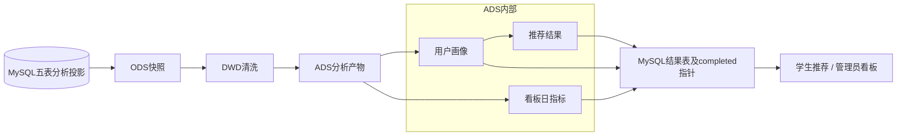

# 毕业设计7分钟答辩演示脚本

## 当前状态与使用口径（2026-10-24整理）

截至2026-10-24，当前代码基线为 ca697535d3f6903785aa63838da5083346dacc97，认证和部分界面改动仍在工作区，尚未提交，也未创建新的冻结标签。当前平台源批次为 20261024T054843Z_de437452。正式范围为已发布、含章节、非验收且未隐藏的5门课程；DWS为任务内逻辑聚合职责，Spark为local[2]离线处理。以下原始内容保留当时的设计、授权边界和验证数字；其中“本轮”“尚未”“等待确认”只指原阶段，不代表本次整理或当前状态。

当前演示使用5门正式课程、25章课程视频，4份学习者画像，2种推荐算法共40行结果。student_demo已开始5门、完成0门；完成2个章节不等于完成2门课程。正式课程行为99次，章节浏览108次、视频播放156次，均为现有批次统计，并非本轮新操作或真实学生研究结论。推荐内容评分仍为60%标签余弦、25%个人行为、15%热度，分数不是准确率。章节浏览和播放已纳入分析；观看时长未纳入。平台完成状态以章节记录为准，历史完成操作单独保留。

演示顺序建议：背景30秒→学生课程学习90秒→画像和推荐120秒→管理员看板90秒→Spark链路60秒→总结30秒，共7分钟。演示前登录并检查批次；现场浏览/播放会产生新事件，刷新页面不会运行Spark。OULAD需单独切换来源，不能用其28785名外部学生冒充平台用户。

旧标签final-defense-20261013及123/122、36/30等数字只用于历史追溯。当前没有新冻结标签；不要把本轮工作区内容声称已经包含在旧标签中。不要固定宣称数据库只有12张表或只抽取五张表：认证新增辅助表，当前章节分析也读取章节相关数据。本次只整理文档，不重新查库或产生新的测试结果。当前依据为 ../outputs/formal-course-scope-acceptance-report.md、../outputs/login-experience-acceptance-report.md 及 ../outputs/oulad-analysis-acceptance-report.md。

## 原阶段说明（历史保留）

> 以下保留原始记录，不作为当前数字或新冻结版本的声明。答辩使用上方当前口径；历史测试结果不追写为最新结果。

编写日期：2026-10-13。事实依据为冻结标签 **final-defense-20261013**，标签提交 **7ed3a3755abcef0e7fd57bbd10ac3dfb1b4e0f85**，业务代码基线b8474f2。题目：**基于Spark的学习行为分析与个性化资源推荐系统设计与实现**。

本次仅编写文档，不登录系统、不修改数据库/配置、不运行Spark。脚本是基于已验收事实的演示方案，不是新增运行验收。现场页面数字如有变化，以实际批次和截止时间为准。

## 一、开场前准备（不计入7分钟）

1. 提前确认已有MySQL80、FastAPI8000、Vue5173服务可用；入口为`http://127.0.0.1:5173/login`。按`docs/defense-startup-guide.md`使用已有启动脚本，不现场安装依赖或改配置。
2. 准备student_demo、admin_demo已有密码，登录时不显示明文、不打开账号文件、不展示令牌/环境变量。管理员切换建议复用同一浏览器退出后登录，或提前准备真正隔离的浏览器会话；普通同浏览器多标签可能共享登录状态。
3. 确认正式PySpark课程1069、第2章“筛选与列转换”、视频`course_1069/chapter_007.mp4`可访问，准备静音/音量和投影显示；只播放10–15秒。
4. 保留当前批次`20261013T052412Z_1fc73f17`，不在7分钟演示中重算Spark、创建课程、保存、发布、收藏或点击完成章节。
5. 准备已有真实证据：`outputs/defense-demo-acceptance-20261013/`中的学生首页、详情、视频、推荐、AI及完整看板截图；它们多数被Git忽略，跨机器展示要事先另行复制，不假设标签包含附件。
6. 正常进入课程/播放视频会新增事件，AI调用会新增问答；本脚本不授权现在执行这些动作。若现场要求数据库零新增，改用已有截图与验收记录，并说明是在展示历史证据。

## 二、7分钟时间轴

| 时间 | 内容 | 时长 |
|---|---|---:|
| 00:00–00:30 | 项目背景 | 30秒 |
| 00:30–02:00 | 学生端流程 | 90秒 |
| 02:00–04:00 | 画像与推荐系统 | 120秒 |
| 04:00–05:30 | 管理员分析 | 90秒 |
| 05:30–06:30 | Spark数据流程 | 60秒 |
| 06:30–07:00 | 项目总结 | 30秒 |

合计420秒。以下讲解词为可直接练习的口述稿；点击、页面等待和视频播放也计入相应时间。网络或页面阻塞超过10秒立即切备用证据，不延长现场排障。

### 1. 项目背景介绍

**时间：**00:00–00:30。

**操作：**展示标题页；指向“学习行为→分析→推荐”的目标，不展开部署细节。

**页面：**答辩标题页或README项目简介。

**讲解词：**

“各位老师好，我的毕业设计是基于Spark的学习行为分析与个性化资源推荐系统。项目希望把课程浏览、学习进度和收藏等分散记录汇总起来，形成用户画像和有理由的资源推荐。我采用在线学习业务与离线分析相结合的方式，完成从操作记录、数据处理到结果展示的工程闭环。”

**展示重点：**本科工程应用目标、学习行为和推荐之间的关系。不要声称已证明提高成绩或推荐准确率。

### 2. 学生端流程

**时间：**00:30–02:00。

**操作：**

- 00:30–00:45：student_demo登录，密码隐藏输入。
- 00:45–00:55：首页展示learner身份及python/spark兴趣。
- 00:55–01:15：进入学习资源，搜索“PySpark”，打开1069课程详情。
- 01:15–01:40：点击继续学习，选择第2章“筛选与列转换”，播放视频10–15秒后暂停。
- 01:40–02:00：展示教学目标、示例代码、“学习行为已记录”提示和已有章节进度；不点击完成。

**页面：**`/login`→`/`→`/resources`→`/resources/1069`→`/resources/1069/learn`。

**讲解词：**

“这里使用学生演示账号登录，首页显示当前身份和兴趣标签。我选择PySpark课程，进入章节学习。每章把教学目标、真实视频、知识讲解、代码和练习放在一起。这里播放一小段视频，然后暂停。进入资源和操作播放器会按现有规则记录学习行为。页面显示既有学习进度，视频结束不会自动完成章节，需要学生手动确认；这个进度描述学习流程，不代表已经掌握知识。”

**展示重点：**真实登录、课程内容、视频时间推进和记录提示；首次开始/整课完成才通过桥接进入主分析事件，不把全部章节事件说成直接进入Spark。

**事实边界：**5门正式课程、每门5章；另有隐藏课，不列为正式课程。学生列表还含历史验收资源，用搜索定位，不删除。已有验收仅证明该视频实际播放约63秒及25文件媒体验收，不证明25章浏览器全片均播放完毕。没有独立前端学习历史页；需要展示事件明细时使用预先准备的事件API验收证据，不输入不存在的history路由。

### 3. 用户画像与推荐系统

**时间：**02:00–04:00。

**操作：**

- 02:00–02:35：进入推荐页面，展示显式兴趣和行为兴趣画像。
- 02:35–03:00：指向活跃天数、行为次数、课程完成情况、生成时间和统计截止。
- 03:00–03:30：展示内容推荐卡片、排序和推荐理由。
- 03:30–03:50：切换热门推荐作对照，说明两种算法的评分口径。
- 03:50–04:00：指出新操作不会因页面刷新立即进入离线画像。

**页面：**`/recommendations`；画像位于此页面，没有独立`/profile`页面。

**讲解词：**

“这里展示当前用户画像。显式兴趣来自用户设置，行为兴趣反映已记录的学习活动。活跃天数和浏览、开始、完成、收藏次数用于描述学习行为，而不是评估学习能力。下面是内容推荐，卡片给出资源和推荐理由，说明它与兴趣或已有行为的关系。

“推荐提供热门基线和融合内容方法。有历史行为时，内容评分由60%的标签余弦相似度、25%的归一化个人行为和15%的资源热度组成；没有历史行为时采用热度回退。同时过滤已完成或不可见资源。这里的百分比是排序得分，不是命中概率、准确率或学习效果提升。

“页面同时显示批次和统计截止时间。这是预先计算并发布的离线结果，刚才的新浏览不一定已经进入画像。切换算法和刷新只读取已有结果，需要下一次完整批处理才能生成新的分析结果。”

**展示重点：**兴趣解释、行为统计含义、推荐理由、60/25/15融合、热门对照、完成过滤、批次可追溯。配比用于推荐评分，不要与画像兴趣组合权重混淆。

**事实边界：**冻结验收时student_demo内容推荐3张卡，PySpark86.7%、MySQL35.6%、HDFS17.8%；现场不承诺这些数字固定。冻结画像为活跃6天、浏览95次、开始9次、完成5次、收藏4次、取消1次，仍是该批次口径。

### 4. 管理员分析展示

**时间：**04:00–05:30。

**操作：**

- 04:00–04:15：退出学生账号，登录admin_demo；或切到提前准备的独立管理员会话。
- 04:15–04:35：管理员后台展示用户只读表、角色；快速展示课程列表，不编辑。
- 04:35–05:15：进入数据看板，指向用户/资源统计、行为趋势及学习完成情况。
- 05:15–05:30：展示推荐结果统计及看板批次、数据来源。

**页面：**`/`→`/admin`用户查看、`/admin/courses`→`/dashboard`。

**讲解词：**

“管理员端可以只读查看用户身份和状态、课程与资源信息，并查看已发布分析。这里有六个账号，分为四个学习者和两个管理员。看板展示行为趋势、资源分类、学习完成情况及推荐统计，并标明源批次和统计截止。

“要注意数据来源：行为趋势和学习统计来自离线快照，资源分类来自当前MySQL。课程完成率只描述记录的流程状态，不等于能力评测。推荐物理产物是36行，看板排除联调资源后展示30行，而学生看到的是自己的推荐卡片，这三个数的范围不同。”

**展示重点：**角色权限、用户只读、四个图表、数据来源标注、筛选口径。只说明当前真实管理能力，不宣称用户编辑/停用功能；资源课程维护接口虽存在，本次不演示写入。

**事实边界：**当前批次看板有效学习者行为119；DWD总有效122，筛选范围不同。看板资源12/已发布11；数据库物理资源13；正式教学5课25章，管理员列表还含1门隐藏课。不要将30自然日指标误称30个用户。

### 5. Spark流程说明

**时间：**05:30–06:30。

**操作：**展示下方流程图；在已打开的批次截图或`/admin`“Spark批次”标签指向completed、源批次与各阶段数量。仅解释已有产物，不现场运行命令。

**页面：**流程图/当前状态说明；`/admin`→Spark批次；已有发布及Parquet验收报告。

**讲解词：**

“数据从MySQL抽取五张核心表的分析字段，形成同一批次ODS快照。DWD完成清洗、去重和无效回执过滤；任务内聚合生成ADS画像、推荐及看板指标，校验后发布结果表和完成指针。画像和推荐本身就是ADS产物，不是ADS之外又多了一套存储层。

“当前源批次来自10月13日，123条学习事件清洗得到122条有效记录，过滤1条无状态变化回执；生成4行用户画像、36行推荐及30个自然日指标。文件读回、哈希和发布状态均有验收证据。Spark运行在本机local[2]，这里没有部署HDFS集群或实时训练。”

**展示重点：**MySQL→ODS→DWD→ADS，ADS中包含用户画像→推荐；同源快照、123=122+1、Parquet校验和completed发布。DWS为任务内逻辑聚合，没有独立物理目录。

**批次备用说明：**源`20261013T052412Z_1fc73f17`，画像后缀`_p1_5f4a3dd7c998`，推荐后缀`_r1_587c243a0d860c24e7f0`，看板后缀`_d1_6848cd21cf6f`；截止北京时间2026-10-13 13:24:11.782。历史10月10日90→89不能混作当前批次；演示后业务事件125条也不等于ODS123条。

### 6. 项目总结

**时间：**06:30–07:00。

**操作：**返回总结页，结束页面操作，留出提问时间。

**页面：**总结页或README简介。

**讲解词：**

“本项目完成了学生学习、行为记录、Spark离线处理、画像推荐和管理员分析展示的工程闭环。主要特点是数据来源和批次可追溯、行为规则可验证、推荐理由可解释。AI作为辅助问答模块，不替代推荐分析。当前验证基于小规模开发样本，尚不能证明真实教学效果或集群性能。我的汇报结束，谢谢各位老师。”

**展示重点：**真实完成、工程贡献与限制；不要补充没有同版本实验依据的准确率提升数字。

## 三、老师可能提问与建议回答

| 问题 | 建议回答 |
|---|---|
| 1. 数据量这么小，为什么用Spark？ | 本科项目重点是实现并验证清洗、聚合、画像、推荐和批次发布链路。Spark提供DataFrame/SQL及Parquet处理能力，但当前小样本不能证明其规模优势或吞吐能力。 |
| 2. Spark在哪里真正参与了计算？ | spark/jobs与spark/utils使用Spark DataFrame/SQL完成ODS读写、事件清洗、聚合和推荐计算，并保存Parquet；不是普通Python统计后贴Spark名称。已有实际运行与文件读回证据。 |
| 3. 为什么没有HDFS？ | 当前为本机local[2]，Parquet存本地文件系统，足以验证工程链路。HDFS是平台中的课程主题，不是已部署组件。 |
| 4. ODS、DWD、DWS、ADS分别是什么？ | ODS是同源分析快照，DWD是清洗后的明细，DWS是任务内逻辑聚合，ADS是画像、推荐和看板产物；只有ODS/DWD/ADS独立落盘。 |
| 5. 为什么用户画像出现在ADS里？ | 画像是可发布的分析结果，推荐再消费它和同源数据；两者都是ADS产物。不能将“ADS→画像→推荐”解释成另建两层物理存储。 |
| 6. 数据库有多少表？为什么Spark只抽五表？ | 实际12表；抽取users、resources、learning_progress、favorites、learning_events的分析投影。其他表支持章节和AI等业务，不全部作为推荐输入，密码和正文等字段不在分析投影里。 |
| 7. 视频播放是不是直接影响推荐？ | 视频播放记入章节事件；现有Spark不会直接抽取全部chapter_events，也没有把观看时长作为特征。课程首次开始和整课完成按桥接规则进入主事件。 |
| 8. 刷新页面后推荐为什么不变？ | 页面读取已发布离线批次，刷新不触发任务。新行为需要下一次完整计算和发布；查询仍会检查当前资源可见性与完成状态。 |
| 9. 123条怎么变成122条？ | 当前批次过滤1条no_state_change回执，123=122+1守恒。它是规则性排除，不是数据丢失或程序失败。 |
| 10. 122条与看板119条为什么不同？ | 122为DWD全部有效事件；看板另筛选active learner，统计范围不同，不能直接比较为缺失。 |
| 11. 为什么推荐有36条、看板30条、学生3张？ | 36是全体用户与两种算法的物理结果；看板过滤联调资源后30；当前学生单算法可见3张卡。分别是不同筛选范围。 |
| 12. 6账号为什么只有4行画像？ | 6账号中4个学习者、2个管理员；当前画像产物面向学习者。历史结果累计38行还包含多批次，不能当作38位用户。 |
| 13. 推荐算法是什么？为什么不用ALS？ | 提供热门基线及content_v1融合方法：有历史时60%标签余弦、25%归一化个人行为、15%热度，无历史热度回退。当前样本小且稀疏，没有实施ALS，不编造对比优势。 |
| 14. 这些权重怎样确定？ | 当前是工程规则配置及已实现的融合方案，不宣称全局最优。要论证最优权重，需要同版本、同数据切分的实验或消融验证，现有发布验收不能替代它。 |
| 15. 86.7%是不是准确率？ | 不是，它是综合排序分的百分比显示；不等于概率、Recall或准确率。 |
| 16. 如何处理冷启动？ | 有历史时使用融合评分，没有有效历史时热度回退。已设置兴趣和行为兴趣职责不同，不把画像权重与评分权重混为一谈。 |
| 17. 如何证明推荐比热门好？ | 本版本能证明处理与发布链路、过滤和展示规则；工具中有时间划分与Recall@10/NDCG@10/Coverage评价，但没有可引用的同版本真实学习收益证明，不给出虚构提升率。 |
| 18. 数据来自真实学生吗？ | 当前主要是开发验收样本；另有明确标记的模拟实验数据。两者都不能当作真实学生使用研究，更不能证明成绩提升。 |
| 19. 如何避免重复行为？ | 请求使用UUID和数据库事务，同UUID同语义返回已有结果，冲突拒绝；已有浏览幂等验收。它不是未经验证的任意分布式exactly-once承诺。 |
| 20. 什么叫发布成功？失败怎么办？ | 产物经过Parquet读回、哈希和业务校验，画像/推荐写入MySQL，成功后完成指针更新。失败路径保留此前成功latest；文件与数据库不是分布式事务，所有异常恢复不能由一次成功推导。 |
| 21. 播完视频就证明学生学会了吗？ | 不证明。播放结束不自动完成，学生手动确认；进度描述流程状态，浏览器事件不是可信观看时长，也没有自动练习评分。 |
| 22. 管理员可以修改用户角色吗？ | 本系统用户管理页是只读查看；资源/课程维护接口存在，但不能宣称有不存在的用户编辑或停用功能。本次演示只展示管理读取。 |
| 23. AI与推荐是什么关系？ | AI是独立辅助答疑，通用或基于课程关键词资料提供回答；推荐由Spark规则计算，不由大模型生成。没有向量数据库或自动多轮记忆结论。 |
| 24. AI是否稳定、是否可靠？ | 已验收一次agnes-3.0-flash通用请求成功，并有历史记录；外部网络和服务可能失败，回答需要核对，不能保证每句专业正确或所有调用成功。 |
| 25. 界面显示的时间为什么是UTC？ | 事件及批次时间以UTC记录，业务自然日按Asia/Shanghai。当前截止05:24:11 UTC对应北京时间13:24:11，不把时区差当成批次异常。 |
| 26. 换台电脑能直接运行吗？ | 标签冻结源码和文档，不含本机数据库、WSL磁盘、依赖、JAR或多数分析数据及证据附件；必须另行恢复安全凭据和运行资料，全新机器一键恢复未验收。 |
| 27. 项目的创新是什么？ | 主要是在线学习事件与离线分析集成、版本追踪、可解释推荐及课程AI伴随学习的应用设计，不宣称新算法、新大模型或原创推荐理论。 |

回答原则：先说明当前实现，再指出证据范围；不把设计计划、历史成功、模拟指标或界面提示推导为本轮未验证能力。

## 四、演示失败时备用方案

| 情况 | 现场处理 | 可直接使用的说明 |
|---|---|---|
| 登录失败/会话丢失 | 确认账号角色与入口；不现场重置密码、改JWT或数据库。等待超过10秒切01-student-home.png或08-admin-home.png。 | “当前登录会话未恢复，我用此前真实验收截图说明身份和流程；这不代表本次登录成功。” |
| 前端/接口打不开 | 使用本机已准备截图、流程图及HTTP/API验收记录，不现场安装或改配置。 | “实时访问暂时不可用，下面展示冻结版本对应的既有证据；服务异常需要演示后单独诊断。” |
| 列表找不到正式课程 | 用课程标题搜索定位1069；不删除历史资源，不创建新课。仍失败则切02/03截图。 | “列表同时保留历史验收资源，我演示的是正式PySpark课程。” |
| 视频缓冲/无声音/播放错误 | 不连续刷新或切换25章；切04-video-learning.png及video-playback.json，播放只用预先核对过的同版本本地媒体备份。 | “该文件此前已实际播放；当前播放或音频通路存在问题，不能把此次尝试称为成功。” |
| 行为提示或记录请求失败 | 不反复点击完成/收藏，不伪造记录；展示已有事件API与数据变化验收。 | “这次行为写入尚未确认，已有验收记录证明实现路径；本次是否写入需后续核查。” |
| 推荐为空、批次不同或数量变化 | 展示实际提示、统计截止、算法与过滤范围；切06-student-recommendations.png。 | “推荐是离线结果且有在线过滤，条数不是固定承诺；不能为现场展示修改数据或临时重算。” |
| 管理员权限错误 | 切换到正确admin账号或08/10/13截图，不更改角色。 | “当前会话没有管理员权限，系统拒绝访问符合权限边界；我用已核验管理员证据继续。” |
| 看板图表未渲染 | 保留真实错误，切13-admin-dashboard-full.png和批次页；不修改数据来源或图表代码。 | “图表当前加载异常，已有同源统计和真实截图可说明结果，实时渲染本次未确认。” |
| AI超时、限额或远程失败 | 不反复发送、不改Key/代理/模型；展示07-ai-answer.png或成功历史。AI不占用主时间轴，必要时跳过。 | “AI依赖外部服务，当前请求未成功；核心学习与Spark推荐不依赖这次问答。” |
| 老师要求现场重跑Spark | 先说明任务会写新文件并发布数据库结果，7分钟内用已有完整计算报告与completed批次解释；另行明确授权后安排独立环节。 | “本次展示冻结产物；现场重跑会产生新批次，当前演示没有执行，也不把旧结果当新运行。” |
| 投影字号小/页面过长 | 聚焦课程内容、画像、批次/看板；使用事先检查过的截图。超过10秒停止调试。 | “我用相同版本的局部证据展示关键信息，并保留批次和限制说明。” |

备用截图目录：`outputs/defense-demo-acceptance-20261013/`。跨机器前逐一确认文件存在；原始`screenshots/`目录中的10月11日图片是历史批次，不把75%/90→89改称当前86.7%/123→122。没有备用证据时如实说明未展示成功，不生成虚构截图。

## 五、答辩前最后核对卡

- 学生student_demo、管理员admin_demo；只有隐藏输入密码，不投屏凭据文件。
- 当前源批次20261013T052412Z_1fc73f17；123→122+1；画像4、推荐36、趋势30自然日。
- 12张业务表；ODS只抽五表；5正式课25章/25媒体，另有1隐藏课1章。
- local[2]、ODS/DWD/ADS、DWS逻辑聚合；60/25/15是评分规则，不是效果提升。
- 新事件不会实时改变旧画像；无独立/profile或学习历史页面；不演示不存在的功能。
- 不完成章节、不收藏、不保存/发布课程、不现场重算；零新增要求下使用已核验截图。
- AI可选增强；25全片、全部AI、管理写入、集群性能及真实教学效果均不是本次已覆盖结论。
- 7分钟到点收尾；本轮生成脚本不提交Git、不移动冻结标签。

事实来源：冻结标签中的`docs/final-release-checklist.md`、`docs/defense-current-state.md`及`outputs/post-expansion-final-acceptance-report.md`、`outputs/defense-demo-acceptance-20261013/defense-demo-acceptance-report.md`。
