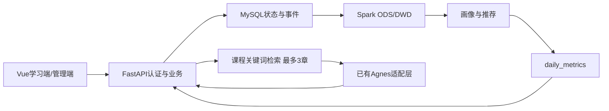

# 最终项目验收与答辩准备

初稿日期：2026-10-05；当前口径修订：2026-10-13。本文操作说明以[当前状态](defense-current-state.md)及[当前启动说明](defense-startup-guide.md)为准。历史测试证据保留原日期，本轮仅修订文档。

## 当前系统功能与架构

|模块|功能|范围限制|
|---|---|---|
|用户|注册、JWT登录、兴趣标签、个人信息|管理员/学习者两角色|
|课程资源|搜索、分页、发布、目录、教学正文/目标/代码/练习|正式25个MP4已提供；10月13日单章浏览器真实播放通过，全量播放边界见当前状态|
|学习|浏览、收藏、章节进度与事件、课程完成|全部章节完成才桥接课程完成事件|
|Spark|MySQL快照、ODS/DWD、质量报告、画像、推荐、统计|本机local离线任务，人工编排|
|推荐|热门基线、混合内容推荐、冷启动、可解释原因|无ALS，不证明教学效果|
|AI|通用模式、课程关键词检索、真实引用、历史与错误处理|无向量库，无自动多轮记忆|
|管理|课程/章节维护、用户只读、资源、批次、看板|没有复杂权限体系|

技术栈：Windows+WSL2 Ubuntu22.04、Java17、Python3.11、PySpark3.5.7、MySQL8、FastAPI/SQLAlchemy、Vue3/TypeScript/Vite/Element Plus/Pinia/Vue Router/Axios/ECharts。现有Agnes适配层和安全配置复用。



当前12表：users、resources、learning_progress、favorites、learning_events、user_profiles、recommendation_results、ai_qa_records、course_chapters、chapter_progress、chapter_events、ai_course_contexts。迁移001至007，本阶段不执行迁移。daily_metrics是Parquet及JSON，不是MySQL表。

## AI设计与真实引用

通用POST /api/ai/questions；课程POST /api/resources/{course_id}/ai/questions。复用认证、UUID幂等、额度、用户隔离、历史和超时。课程上下文包含课程名/简介/分类/标签及章节教学目标、知识点、正文、示例和练习，以关键词相关度选最多3章并限制上下文长度。

references由后端实际检索且发送的上下文生成并保存，不从模型输出推断。没有相关资料时引用为空，提示“当前课程资料中未找到相关内容，以下回答基于通用知识。”真实引用不意味着每句话均已核验，模型仍可能出错。AI问答不自动产生学习事件或完成章节。

课程资料外发必须同时获得服务端许可及用户本次确认，并检查敏感凭据。只有APP_ENV=development支持AI_ALLOWED_RESOURCE_IDS=*；生产支持指定ID/空名单，生产*拒绝。隐藏或未发布课程不可用。配置环境变量优先，Key由原安全加载器读取，不写前端、测试、文档。

## Spark流程与推荐说明

pipeline → user_profiles → recommendations → dashboard_metrics。读取五张核心表分析投影，单JDBC一致性快照、每表最多50000行，排除密码等隐私。ODS保留批次、来源与快照；DWD清洗非法引用、类型、重复UUID、时间及无效回执。成功校验后发布latest，失败保留旧成功结果。

chapter_events并未直接加入当前Spark抽取。课程首次开始/全部章节完成通过learning_events桥接进入分析；视频观看次数、章节完成率、学习时长和AI问答未纳入推荐特征，不能宣称已有这些分析。

content_v1当前算法版本hybrid-v2：score=0.6×标签匹配+0.25×归一化个人行为+0.15×归一化热度。无有效历史使用热门，过滤下架、完成、重复和隐藏资源。旧批次可能仍是旧版本，需要检查批次元数据。看板读取daily_metrics及配套画像/推荐批次，前端不计算统计，业务写入不会立即刷新离线结果。

## 创新点与答辩边界

特色是在线学习事件与Spark离线处理闭环、版本化Parquet与批次可追溯、可解释混合推荐、真实章节来源的课程AI及伴随学习布局。属于工程集成与应用设计，不宣称原创大模型、推荐理论或集群性能创新。时间划分实验指标包括Recall@10/NDCG@10/Coverage，合成样本不能证明真实教学收益。课程完成不等于防作弊观看完成；正式媒体已提供并有单章真实播放证据，未验收25章浏览器全片播放；生产安全部署和规模压测未验收。

## 历史写入型演示方案（8–12分钟，非本次只读优先流程）

以下创建/发布课程、完成章节及Spark重算会改变数据，仅保留为另行授权后的方案。日常答辩优先采用[当前演示说明](defense-startup-guide.md)，不执行这些写入步骤。

1. 双击start-project.bat，确认MySQL、后端8000与前端5173；凭据不截图。管理员手动登录admin_demo，在/admin/courses创建单独演示课程、两章并发布，记录课程ID。此为后续人工演示步骤，本轮未创建正式数据。
2. student_demo登录，搜索课程，进入/resources/:id/learn；展示目录/教学资料、收藏、章节完成百分比。完成全部章节验证课程完成。
3. 使用课程助手提问与真实章关键词相关的问题，确认外发，展示回答与references，点击引用比对原章。宽屏右侧助手，小屏折叠。
4. 无相关章节问题展示空引用与通用知识提示；切通用AI并查看历史。供应商失败时展示友好错误或历史，不能声称当前调用成功。
5. 查看本人事件/进度/收藏/章节事件，说明章节事件与课程开始/完成桥接。AI问答本身不会产生学习行为。
6. 暂停其他写入，按以下命令运行四任务。记录每个成功批次和同源source_batch_id，再展示推荐、/dashboard与管理员批次。完成课程可能被推荐过滤，推荐不会因浏览器刷新立即重算。

```bash
source /mnt/d/BigDataGraduationProject/environments/activate-bigdata.sh
cd /mnt/d/BigDataGraduationProject
python -m spark.jobs.pipeline
python -m spark.jobs.user_profiles
python -m spark.jobs.recommendations
python -m spark.jobs.dashboard_metrics
```

截图建议：F01登录身份，F02课程章节管理，F03学习资料/进度，F04AI回答与引用，F05原章核对，F06无匹配/通用模式，F07个人行为与桥接，F08四阶段批次，F09推荐原因，F10看板更新时间/来源。必须来自正式localhost:5173，不用模拟HTML；避开Token、密钥和用户隐私。

## 证据边界与冻结规则

自动化覆盖管理员创建发布、学习事务、AI许可/引用、Spark计算与前端交互。供应商采用受控替身，不能替代真实Agnes质量验收；分模块自动测试也不能冒充同一真实账号的一次浏览器端到端运行。历史real-account-browser-integration-report.md是早期正式账号资源演示证据，早于最终课程AI布局。

本轮未重新操作浏览器、调用真实Agnes或发布线上Spark批次。最终演示前仍需本人完成上述真实浏览器闭环与截图。冻结后仅在明确授权下修复阻断缺陷并回归，不扩大功能。
