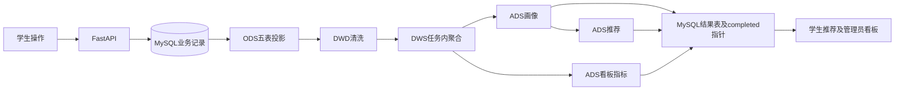

# 最终答辩交付清单

冻结日期：2026-10-13。最终标签：`final-defense-20261013`（本轮文档提交完成后创建）。业务代码基线：`b8474f2eab789bf3d16463a41f1bfa27cf7dc432`；最终提交仅包含文档，标签解析出的提交为最终交付版本。提交哈希及标签核验见本轮冻结结果报告，不在提交内自引用未知哈希。

## 1. Git与安全检查

- 冻结前27个跟踪文件修改，均为Markdown；14个未跟踪文件（13个文档，1个明文账号密码文件）。此前材料修订共53个正文文件，部分历史报告被忽略，仍纳入精确文档白名单。
- 暂存区开始为空；已有标签final-defense-20261013不存在。本轮只暂存已审查Markdown文档，不执行git add -A，不强制移动既有标签。
- 风险文件：根目录`2026.10.1毕设账号密码.txt`为未跟踪明文凭据文件，明确不提交、不读取、不删除；应私密保管，答辩不要展示。`.env.local`及运行凭据安全存储不提交。
- 候选文档扫描未发现高置信API令牌、JWT、GitHub令牌或私钥；跟踪文件路径未发现真实.env或明显敏感账号/私钥文件。扫描不等于整个Git历史的完整安全审计。
- 不提交新数据库数据、WSL磁盘、依赖目录、运行日志、截图或JSON证据；本次提交是最终文档和交付说明。
- 本轮不修改数据库、不运行Spark、不安装或更新依赖，不修改业务源码；307个非Markdown跟踪文件保留哈希基线，提交后复核。

## 2. 项目结构

| 目录 | 检查结果 | 用途及交付边界 |
|---|---|---|
| backend | 存在；app/main.py、requirements.txt存在 | FastAPI业务服务，代码保持原版 |
| frontend | 存在；package.json/package-lock.json存在 | Vue页面；node_modules为本机依赖，不新提交 |
| spark | 存在；pipeline/画像/推荐任务及JDBC JAR存在 | 现有local[2]批处理，JAR被忽略，不新运行 |
| docs | 存在；论文七章、大纲、架构、演示/启动说明存在 | 最终文档冻结对象；草稿不等于学校成品排版 |
| data | 存在；ods/dwd/ads目录存在 | 本机运行数据，被忽略；标签不包含它们 |
| wsl | 存在；Ubuntu-22.04/ext4.vhdx存在 | 已恢复发行版磁盘，被忽略；标签不包含完整运行环境 |

另有database/migrations、environments/activate-bigdata.sh、scripts/start-project-service.sh及start-project.bat；全部关键启动路径存在。仅静态文件检查，没有本轮启动验收。

## 3. 技术栈版本

| 层 | 固定版本/方式 |
|---|---|
| 平台 | Windows + WSL2 Ubuntu-22.04-Recovered |
| Python / Java | Python3.11.17 / OpenJDK17.0.20.1 |
| MySQL | 8.0.45；12张表，SQL迁移001—007 |
| Backend | FastAPI0.115.12、Uvicorn0.34.2、SQLAlchemy2.0.40、PyMySQL1.1.1、PyJWT2.10.1、httpx0.28.1 |
| Frontend | Vue3.5.43、TypeScript5.9.3、Vite7.3.6、Node22.22.2/npm10.9.7 |
| 页面依赖 | Element Plus2.14.7、Pinia3.0.4、Vue Router4.6.4、Axios1.20.0、ECharts6.1.0 |
| 分析 | Spark/PySpark3.5.7、Java17、local[2]、Spark SQL、Parquet、Connector/J8.0.33 |

版本取自已确认运行验收和当前依赖声明，本轮未重装或重新运行环境验证。详细出处见[当前状态](defense-current-state.md)。

## 4. 启动方式

复用已运行MySQL80、后端8000及前端5173。Windows已有入口`start-project.bat`；如服务未运行，两个WSL终端分别执行已有脚本：

```bash
cd /mnt/d/BigDataGraduationProject
bash scripts/start-project-service.sh backend
```

```bash
cd /mnt/d/BigDataGraduationProject
bash scripts/start-project-service.sh frontend
```

浏览器使用http://127.0.0.1:5173/login；后端检查http://127.0.0.1:8000/openapi.json。脚本复用原Python环境与安全凭据，禁止把真实Key/JWT/密码复制到报告。停止所属服务终端Ctrl+C，演示期间不要关闭WSL。详细说明：[当前启动指南](defense-startup-guide.md)。冷启动、全新机器恢复或双击启动不是本轮新增验收结论。

## 5. 数据流程与当前结果



实际落盘ODS/DWD/ADS；DWS没有独立目录。现有任务人工顺序pipeline→user_profiles→recommendations→dashboard_metrics；刷新网页不触发重算。chapter_events仅按首次开始/整课完成桥接到learning_events，不直接全量进入Spark。

最新源批次：`20261013T052412Z_1fc73f17`，快照截止2026-10-13 05:24:11.782 UTC（北京时间13:24:11.782）。当前ODS五表6/13/11/3/123；DWD有效122、过滤1（no_state_change）；画像4、推荐36、日指标30自然日；四阶段completed同源。当前发布后累计画像38/推荐472，不是本批次人数。

画像批次：`20261013T052412Z_1fc73f17_p1_5f4a3dd7c998`；推荐：`20261013T052412Z_1fc73f17_r1_587c243a0d860c24e7f0`；看板：`20261013T052412Z_1fc73f17_d1_6848cd21cf6f`。

演示后业务事件125、章节事件261、AI记录51属于后续验收快照，未纳入ODS123。本轮不查询实时数据、不更新这些快照。10月10日90→89及累计34/436保留为历史证据。看板物理推荐36/可见30/学生3张卡口径不同，详见当前状态说明。

## 6. 答辩演示流程

学生登录→首页身份/兴趣→搜索正式课程→PySpark详情→第2章视频10–15秒并暂停→既有章节20%状态及行为记录说明→画像/推荐理由→管理员登录→用户只读→正式课程/资源→四阶段批次→看板四图→可选AI成功历史。

课程详情、视频及AI正常操作会新增记录；不点击完成/收藏/发布/保存，以免改变已有状态。要求零新增时展示已有截图。现场不推荐临时重算Spark；不要将新操作解释成当前冻结结果的实时更新。

## 7. 已验证功能（引用前轮证据）

- 学生真实登录、首页、课程详情/章节正文、学习状态和推荐展示。
- 单章真实视频：chapter_007.mp4时长232.44秒、实际播放约63秒，无媒体错误；25正式媒体文件有已有静态/解码验收。
- 学习事件持久化、同UUID浏览幂等；演示前后已有数据库行没有修改或删除。
- 管理员用户/资源/课程/发布批次及看板读取，四个图表渲染。
- 一次Agnes通用问答succeeded，前端回答与历史显示，远程结果不作为项目集群/训练依据。
- 前轮完整Spark计算与发布，以及后续10个Parquet只读行数/哈希/成功标记核验。
- 文档一致性修订、链接及代码保护检查通过。

证据：[完整功能与Spark报告](../outputs/post-expansion-final-acceptance-report.md)、[演示验收归档](../outputs/defense-demo-acceptance-20261013/defense-demo-acceptance-report.md)、[材料修订报告](../outputs/defense-material-consistency-revision-report.md)。归档报告引用的截图/日志/JSON为本机被忽略的证据附件，本文档提交不包含这些附件；跨机器展示需另行安全交付。标签不是完整数据库/环境备份。

## 8. 未覆盖限制

未做25章浏览器全片、完整设备/投影显示、所有音画人工验收；未做全部AI模式/远程稳定性/专业正确性保证；未做管理员写操作、完整安全/并发/压力或生产部署验收。没有独立学习历史前端页，状态及事件API是实际展示。没有HDFS集群、ALS、向量检索、实时推荐训练、真实学生学习收益或推荐准确率提升证明；样本含开发验收数据。PPT大纲与论文Markdown草稿不等于学校格式成品。

## 9. 冻结执行清单

- [x] 检查Git修改、未跟踪文件及敏感路径。
- [x] 检查六个项目目录及关键启动文件。
- [x] 生成本清单，审查精确Markdown提交范围。
- [x] 对候选文档执行敏感值扫描，排除账号文件与私有运行材料。
- 提交和标签创建属于本轮后续执行步骤；最终结果以标签与冻结结果报告为准，本文不预先声称成功。

提交意图：仅最终文档及交付说明，禁止包含业务源码/数据库/运行数据变化；标签名final-defense-20261013；无远端推送授权，本轮只本地提交与打标签。
