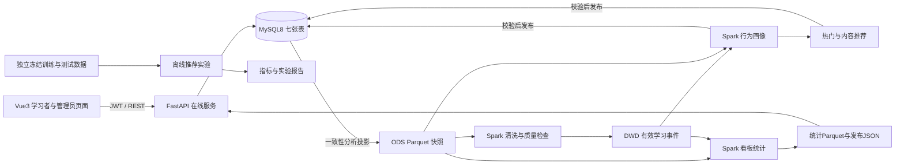

# 系统最终总体架构

> 冻结更新（2026-10-05）：本文件下方保留早期最终验收快照。当前功能、12表数据模型、课程AI、hybrid-v2混合评分及章节事件进入Spark的准确边界，以 [final-project-acceptance-guide.md](final-project-acceptance-guide.md) 为准；下方七表及纯余弦描述不代表当前版本。当前阶段结果见 outputs/project-freeze-acceptance-report.md。

日期：2026-10-05。此文以当前代码、迁移和运行产物为依据。本阶段只做验收与交付整理，不新增业务功能。最终运行结果和限制统一记录于 outputs/final-system-acceptance-report.md。

## 总体设计

系统采用单个Vue3前端、FastAPI在线服务、MySQL8数据库与独立Spark批处理。在线流程负责身份认证、资源维护、学习操作和事务事件记录；离线流程负责抽取、清洗、画像、推荐及统计。前端查询已发布结果，不在页面运行Spark或计算业务统计。

## 模块关系与数据模型

| 模块 | 职责 | 主要接口或产物 |
|---|---|---|
| 用户 | 注册、登录、当前用户、兴趣修改 | JWT、users |
| 资源 | 学习者已发布资源查询；管理员创建/编辑/上下架 | resources |
| 学习操作 | 浏览、开始、完成、收藏、取消收藏 | learning_progress、favorites、learning_events |
| Spark数据链路 | MySQL一致性快照、有效事实清洗、质量报告 | ODS/DWD Parquet及manifest |
| 用户画像 | 兴趣、活跃、学习偏好；无能力画像 | ADS Parquet、user_profiles |
| 推荐 | popular_v1、content_v1余弦相似及冷启动回退 | ADS、recommendation_results |
| 推荐实验 | 时间划分、冻结、Recall@10、NDCG@10、Coverage | 独立实验目录，不替换线上发布 |
| 推荐展示 | 当前用户推荐与配套画像摘要 | /api/recommendations/me、/recommendations |
| 数据看板 | 已冻结行为/资源/完成/推荐统计与来源 | /api/dashboard/overview、/dashboard |
| 管理后台 | 用户只读、资源维护、最近发布批次只读 | /api/admin/users、/api/admin/batches、/admin |

数据库实际七表：users、resources、learning_progress、favorites、learning_events、user_profiles、recommendation_results。迁移顺序001→002→003。不创建规划文档中全部23表；没有daily_metrics数据库表、analysis_batches表或自动迁移服务。daily_metrics是本机Parquet统计产物。

## 在线数据流和权限

登录后JWT标识用户，受保护接口从身份读取用户，不允许客户端选择其他人的私有行为。密码哈希保存，响应不返回密码。普通学习者只能读取已发布资源、自己的状态/事件/推荐；管理员维护资源并查看全局统计与用户摘要。不存在复杂RBAC或第三种角色。

业务动作和事件写入同一事务；event_uuid全局唯一，同UUID相同语义返回原结果，冲突拒绝。无状态变化事件is_effective=0，ODS保留，DWD分析事实排除。事件时间UTC，业务日按Asia/Shanghai聚合。

## 离线数据流与发布

pipeline→user_profiles→recommendations→dashboard_metrics由人工顺序运行。pipeline使用单JDBC一致性连接读取五表分析投影，排除密码、账号隐私及资源正文。每表50000行上限，当前为本机local Spark模式，不宣称集群或分布式抽取性能。

ODS保留来源、批次、快照时间；DWD过滤空引用、非法类型、重复UUID、时间异常与无效状态回执。画像与推荐严格定位同源输入，生成带批次、代码摘要和时间的结果。发布包含Parquet读回、结果校验与MySQL事务；成功才替换latest指针，失败保留此前成功版本。

热门推荐按浏览/开始/完成/收藏加权；内容推荐使用画像兴趣向量与资源标签向量余弦。新用户显式兴趣回退、无兴趣热门回退；过滤下架、完成和重复资源，查询时再检查在线状态。公式与参数以 docs/recommendation-system-design.md、configs/recommendation.json 为准，不在最终验收新增算法。

看板读取Spark统计JSON及固定配套MySQL批次；资源管理在线修改不触发离线重算。管理后台批次只读最近四阶段元数据；completed为发布记录声明，不代表查询时重新校验全部Parquet。

## 实验边界

真实在线开发样本很少；另有明确标记synthetic的50资源、30模拟学习者、冻结训练/测试行为，用于离线对比。模拟数据不写MySQL、不提供真实登录账号、不混入在线latest。指标必须附训练/测试范围、分母、候选规则与来源；合成数据结果不能证明真实学习收益。单算法耗时未独立归因，共享推荐计算只能报告联合时间。

## 技术选型与运行部署

Windows主机运行MySQL，WSL2 Ubuntu22.04运行Python/FastAPI、Node/Vite、Java17/PySpark3.5.7。SQLAlchemy映射现有表，PyMySQL在线连接，Connector/J8.0.33用于Spark抽取。Vue3/TypeScript/Vite、Pinia、VueRouter、Axios、Element Plus、ECharts用于页面。

本机开发通过Vite /api代理连接FastAPI，数据库配置为MYSQL_*环境变量；JWT_SECRET从现有安全存储或进程环境加载。具体固定依赖见backend/requirements*.txt和frontend/package-lock.json。未使用Docker编排、Alembic自动迁移、任务调度平台或生产集群。

凭据不进入代码、报告、日志或Git；data、outputs、虚拟环境、依赖、JAR和WSL磁盘多数忽略Git，因此源码仓库不等于完整可运行交付包。恢复材料与启动步骤见根README。
