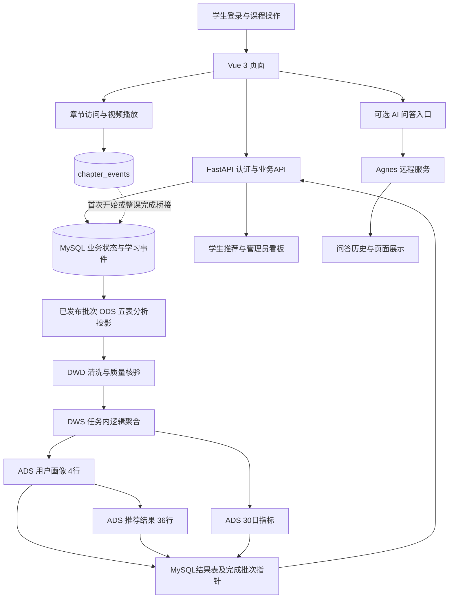

# 答辩演示验收报告

> 文档归档补注：2026-10-13材料修订时复制既有演示报告及相关证据到本目录；不是重新运行验收，正文“本轮”指原演示验收。统一状态见[当前口径](../../docs/defense-current-state.md)。

验收日期：2026-10-13（北京时间）  
项目路径：`D:\BigDataGraduationProject`  
当前Git提交：`b8474f2eab789bf3d16463a41f1bfa27cf7dc432`  
源批次：`20261013T052412Z_1fc73f17`

## 1. 验收结论与执行范围

**核心答辩演示流程通过；材料存在历史口径和展示边界需要说明，不能判定所有材料已与当前数据完全同步。**

本轮以真实浏览器完成学生登录、首页、资源列表、课程详情、视频播放、已有学习状态和推荐展示；完成管理员登录、用户只读查看、资源/课程列表、Spark批次和分析看板；一次通用AI远程调用成功。现有ODS/DWD/ADS文件使用Spark实际只读读回，数据文件与发布指针正常。

只读优先；不编辑业务代码、不安装依赖、不删除文件、不提交Git、不执行数据修复或迁移、不重新生成Spark业务批次。正常浏览与AI调用新增5条业务记录，已有记录逐行摘要前后完全一致，无修改或删除。验证结果见第7节。

闭环证据分两段：本轮用户操作→MySQL持久记录；现有10月13日批次→ODS/DWD/ADS→MySQL发布→真实页面读取。该批次早于本轮新操作，本轮新事件尚未进入旧快照。上轮完整重算证据见同一聊天`outputs/final-acceptance`目录及项目`outputs/post-expansion-final-acceptance-report.md`。本轮没有证明刚产生的事件实时进入推荐，不将刷新页面等同于重算。

## 2. 系统整体流程图

物理落盘为ODS/DWD/ADS；DWS是任务内聚合职责。章节事件不是全部直接抽取到Spark；视频时长与观看完成不构成本项目推荐特征。当前Spark为local[2]，没有部署HDFS集群、ALS或大模型推荐训练。

## 3. 服务与环境状态

| 项目 | 实测结果 | 证据和边界 |
|---|---|---|
| MySQL | 通过 | MySQL80已为Running，无需重复启动；WSL安全读取现有凭据，访问bigdata_graduation成功，12张表 |
| Backend | 通过 | 复用现有FastAPI进程；8000/OpenAPI HTTP200，OpenAPI包含31个路径；读取运行日志，验收接口无5xx |
| Frontend | 通过 | 复用现有Vite进程；5173首页HTTP200，浏览器实际渲染；/api代理成功 |
| 数据库连接 | 通过 | 学生与管理员认证、课程、事件、画像和管理数据均从实际API读取，HTTP200 |
| 环境技术栈 | 一致 | Python3.11.17、FastAPI0.115.12、SQLAlchemy2.0.40、PyMySQL1.1.1、Spark3.5.7、Java17.0.20.1、Node22.22.2；前端声明Vue3.5.43、Vite7.3.6 |
| 浏览器控制台 | 通过 | 所观察会话未捕获error/warn；不等于所有页面或设备均无错误 |

本轮没有重启前后端，因此不能声称重新执行了一次冷启动。现有启动会话上轮已记录startup complete，本轮检查其存续日志、监听端口和实际接口。前后端、MySQL及WSL在验收结束后保留运行。

## 4. 学生端演示流程

账号为现有`student_demo`，角色learner；密码与JWT仅驻留内存，不写报告。

| 顺序 | 步骤 | 结果 | 页面/接口证据 |
|---|---|---|---|
| 1 | 登录 | 通过 | 退出已有会话后重新提交登录，跳转首页；POST /api/auth/login 200 |
| 2 | 首页 | 通过 | / 显示student_demo、learner、python/spark兴趣；01-student-home.png |
| 3 | 课程列表 | 通过 | /resources共11项；5门正式课程与6项历史验收资源；02-course-list.png |
| 4 | 课程详情 | 通过 | /resources/1069显示PySpark课程、published、版本2、既有学习状态与正文；03-course-detail.png |
| 5 | 视频播放 | 通过（单视频） | /resources/1069/learn，第2章筛选与列转换；视频chapter_007.mp4，duration=232.44秒，readyState=4，无error，播放时间实际从0推进到50.63秒，页面到约63秒后暂停；04-video-learning.png、video-playback.json |
| 6 | 学习行为产生 | 通过 | 两次详情读取新增resource_view；进入章节和播放新增chapter_view/video_play；请求日志200，事件API回读成功 |
| 7 | 学习记录展示 | 通过但有界面范围限制 | 页面显示“学习行为已记录”及既有章节20%/学习中；进度/主事件/章节事件API均200。没有独立的前端历史记录路由 |
| 8 | 推荐结果 | 通过 | /recommendations显示当前画像和3张content_v1推荐卡，源批次为10月13日；06-student-recommendations.png |

本轮新增主事件ID为2769、2770；章节事件回读包含chapter_view与video_play（chapter_id=7）。视频播放记录的playback_seconds=0表示开始播放时的事件位置，不能解释为实际只看0秒，也不等于连续观看时长。

没有点击完成章节、收藏、改兴趣或注册账号；已有学习进度、章节完成状态未改。视频只测这一章的加载和时间推进，未做全部25视频逐一播放、完整音画质量和人工听感验收。

当前学生推荐卡片为PySpark数据处理实践86.7%、MySQL数据库基础35.6%、Hadoop HDFS入门17.8%；百分比为综合排序分，不是概率或准确率。画像显示浏览95次、开始9次、完成5次、收藏4次、取消收藏1次，活跃6天，来自冻结批次。刚才新浏览不会立刻改变这些数字。

## 5. 管理员端演示流程

现有`admin_demo`真实登录成功，首页显示admin并出现管理入口；本轮不执行任何管理写操作。

| 步骤 | 结果 | 实际能力与证据 |
|---|---|---|
| 管理员登录 | 通过 | 08-admin-home.png；POST /api/auth/login及GET /api/users/me 200 |
| 用户查看 | 通过 | /admin用户查看列出6个账号的角色、状态、时间；用户是只读查看，没有假设可编辑/停用用户；10-admin-users.png |
| 资源展示 | 通过 | /admin资源列表共13项，含正式、历史联调和下架资源；09-admin-resources.png |
| 课程展示 | 通过 | /admin/courses共6门：5门正式发布课程各5章，另1门隐藏课程1章；12-admin-courses.png |
| Spark批次 | 通过 | 数据管道122、画像4、推荐36、趋势30；四阶段均completed且同源；11-admin-batches.png |
| 学习统计 | 通过 | /dashboard显示清洗输入123/过滤1/输出122，用户6、活跃学习者4、管理员2；有效学习者行为119，课程进度10项/60% |
| 推荐分析 | 通过 | 看板两算法各15条可见结果、4位用户、5个不同资源；不是实验Coverage；13-admin-dashboard-full.png |
| 图表渲染 | 通过 | 4个canvas均具有非零宽高且可见；控制台无捕获的error/warn |

看板资源总数12、已发布11来自当前MySQL并排除联调资源406；用户/趋势/学习等来自快照。36条物理推荐行与看板30条（各15）来自隐藏联调资源过滤；学生3张卡是一个学生/一个算法的可见结果。不要将三个数混为同一口径。

## 6. AI功能状态

- 入口：/assistant及课程学习页面的折叠助手存在。
- 配置：GET /api/ai/capabilities返回enabled=true、ready=true；现有安全配置可由后端加载。没有输出Key、JWT、环境变量全集或数据库密码。
- 本轮只发送一次通用问题，外发内容仅为自编Spark分层教学问题，没有外发数据库内容或课程资料。
- 问题：“请用三句话解释Spark的ODS、DWD、ADS各自职责，并说明离线推荐为什么不会在每次刷新页面时重新计算。”
- 结果：POST /api/ai/questions HTTP200；历史记录status=succeeded，模型agnes-3.0-flash，error_code=null；创建至完成约4.353秒。
- request_uuid：c50af5f1-b938-414a-b093-ee53ea02b69f。
- 前端：显示“回答完成”“通用模型回答，无本站资源依据”，答案及历史新增项可读；07-ai-answer.png。

**内容边界：**AI回答解释ODS/DWD/ADS和预计算，但还提到“批处理集群”“模型训练”“实时微调少量特征”，属于通用场景说明；当前项目没有这些已验证能力。答辩应优先解释自有实现，不能把通用AI输出当项目架构证明。未核验每句专业准确性；本轮未测试课程检索/引用、失败恢复、限额或所有模型。

外发确认控件通过点击可见标签成功勾选；自动化直接check命令一次超时，未修改页面或重发模型请求，不能据此认定用户控件不可用。

## 7. 数据保护与变化核验

验收前后对12张表全部已有行按主键生成SHA256摘要，比较已有记录集合和内容。**已有行修改0、删除0**。对四个latest文件做前后SHA256比较，**全部不变**。业务代码Git diff为空，HEAD仍为b8474f2；未执行git add/commit/push。

| 表 | 前 | 后 | 说明 |
|---|---:|---:|---|
| learning_events | 123 | 125 | 两条新资源浏览 |
| chapter_events | 259 | 261 | 一条章节访问、一条视频播放 |
| ai_qa_records | 50 | 51 | 一条新成功问答 |
| chapter_progress | 21 | 21 | 已有行内容也不变 |
| learning_progress | 11 | 11 | 已有行内容也不变 |
| user_profiles | 38 | 38 | 未发布新画像 |
| recommendation_results | 472 | 472 | 未发布新推荐 |

users6、resources13、course_chapters26、favorites3、ai_course_contexts25均不变。此核验覆盖业务表行内容，不是数据库文件、日志或自增序列逐字节不变。新记录由授权演示正常产生并保留，不做清理。

## 8. 数据链路与Spark分析结果

本轮只读启动Spark会话读取现有Parquet，退出码0；未执行pipeline/user_profiles/recommendations/dashboard_metrics发布任务。

| 层/产物 | 实读行数 | 文件核验 |
|---|---:|---|
| ODS.users | 6 | SHA256及_SUCCESS通过 |
| ODS.resources | 13 | 同上 |
| ODS.learning_progress | 11 | 同上 |
| ODS.favorites | 3 | 同上 |
| ODS.learning_events | 123 | 同上 |
| DWD.learning_events | 122 | 同上 |
| DWD.learning_events_rejected | 1 | 同上 |
| ADS.user_profiles | 4 | 同上 |
| ADS.recommendations | 36 | 同上 |
| ADS.daily_metrics | 30 | 同上 |

全部10个Parquet实际读取、各manifest completed。过滤1条是no_state_change，123=122+1守恒。30是自然日指标行数，不是用户人数。DWD122与看板有效学习者119的差异来自active learner过滤，不是文件丢失。

- 源批次：20261013T052412Z_1fc73f17。
- 画像：20261013T052412Z_1fc73f17_p1_5f4a3dd7c998。
- 推荐：20261013T052412Z_1fc73f17_r1_587c243a0d860c24e7f0。
- 看板：20261013T052412Z_1fc73f17_d1_6848cd21cf6f。
- 快照截止：2026-10-13 05:24:11.782 UTC，即北京时间13:24:11.782。

这些样本包含开发验收数据，不证明真实学生学习效果、推荐准确率提升、分布式性能或生产可用性。本轮辅助脚本首次从聊天work路径运行时没有PYTHONPATH，出现import错误；仅为检查进程设置项目导入路径后只读验证成功，没有改项目文件；初次日志与重试日志均保留。

## 9. 答辩材料检查

检查README、截图说明、架构文档、论文大纲、七章论文草稿、论文一致性审查/修订记录、答辩脚本/PPT大纲与历史指南。14个关键Markdown入口及七章相关本地链接扫描没有缺失。验收报告主要位于outputs，docs以设计/说明/审查资料为主；docs及outputs根目录未找到成品DOCX/PPTX/PDF，不能将Markdown草稿或PPT大纲称为正式论文或成品PPT。

| 检查方面 | 结论 |
|---|---|
| 技术栈 | 最新架构/论文/PPT大纲与实际Vue3/FastAPI/MySQL/PySpark/Java17/Parquet一致；local[2]、非HDFS集群、无ALS的描述正确 |
| 功能范围 | 最新材料明确管理员用户只读、维护接口与本轮验收范围分开；当前页面和路由符合。学习记录已有API和页面状态，没有独立history页面 |
| 推荐公式 | 文档与源码60%标签余弦+25%个人行为+15%热度一致；无历史采用热度回退；不能把评分写成准确率 |
| 数据规模 | 论文测试章主要引用10月10日批次90→89、画像4、推荐36、累计34/436，文本已说明是历史口径；当前批次123→122、累计38/472，应现场引用本报告并注明日期 |
| 截图 | 旧截图真实布局与当前页面一致，但推荐旧批次/75%、35%、15%以及看板90→89/行为86已过时；本轮为新批次/86.7%、35.6%、17.8%及123→122/行为119 |
| 启动说明 | README及现有脚本存在；服务脚本使用Ubuntu-22.04-Recovered，已有环境和安全凭据。README部署参考保留localhost及旧代理说明，现场优先使用已验收127.0.0.1地址与现有脚本 |
| 历史指南 | docs/final-project-acceptance-guide.md仍写占位视频，并建议创建演示课程、完成章节、重跑四任务；这不是本轮只读优先演示流程，不应照做 |
| 稿件完整性 | 七章Markdown草稿、论文大纲、PPT大纲和演示脚本存在；学校格式、参考文献、正式图表/排版和成品PPT交付本轮未验收 |

材料检查是实现、关键口径、链接与现场页面的一致性核对，不是论文逐句学术审校或文献真实性核验。未修改任何旧文档或截图。

## 10. 当前版本风险项

| 编号 | 风险/限制 | 对答辩的影响 | 本轮处理 |
|---|---|---|---|
| R1 | 历史指南写占位视频及有写入演示步骤 | 可能误报视频不可用或误改正式数据 | 记录；采用本报告的流程，不修文档 |
| R2 | 论文、PPT大纲和旧截图为旧冻结版本/批次 | 数字与现场不同 | 记录；介绍采集日期及当前批次，不覆盖历史材料 |
| R3 | 新操作未进入既有离线批次 | 容易错误声称实时更新推荐 | 明确两个阶段和统计截止；本轮不重算 |
| R4 | 没有独立学习历史前端页 | 不宜演示不存在的history路由 | 展示课程状态和事件API证据 |
| R5 | AI通用回答含集群/模型训练等泛化内容 | 容易扩大项目能力 | 记录；AI作为可选增强，不作为架构依据 |
| R6 | 学生列表含6个历史验收资源，管理员含隐藏课程 | 内容观感不够纯净 | 使用标题搜索定位正式课程，不删数据 |
| R7 | 批次页画像快照显示未记录、管道生成时间未记录且提示“旧产物” | 容易被追问来源完整性 | 用源批次/看板截止时间说明；不补字段或修页面 |
| R8 | 截图来自当前窄浏览器，未做投影机宽屏实机验收 | 布局和字大小可能不适于现场 | 保存真实全页证据；现场预先调整浏览器显示尺寸 |
| R9 | Git工作区有未跟踪论文材料及明文账号文件 | 仓库并非全部材料冻结，演示时可能暴露密码 | 不提交、不打开账号文件；保留原状 |
| R10 | 视频仅测1章、AI仅测1次成功 | 不能代表全媒体或远程稳定性 | 明确证据范围，准备已核验截图备用 |

没有发现本轮指定核心流程的阻断性错误；上述材料与口径问题仅记录，没有直接修复。

## 11. 建议答辩演示顺序（约7分钟）

1. 0:00–0:35：题目、研究目标与实际范围；说明工程应用闭环，不夸大真实用户效果。
2. 0:35–1:15：架构图，在线业务与离线分析分离，ODS/DWD/ADS及DWS逻辑职责。
3. 1:15–2:00：student_demo登录、首页兴趣、课程标题搜索；定位PySpark课程详情。
4. 2:00–3:00：第2章目标/代码/练习，视频播放10–15秒后暂停，展示既有20%状态；不点完成或收藏。
5. 3:00–4:05：画像、推荐理由、三张卡片；主动指出批次与截止，评分不等于准确率。
6. 4:05–5:35：admin_demo登录，用户只读、正式课程列表、四阶段completed批次和看板。
7. 5:35–6:10：时间允许时展示AI入口和本轮成功历史；现场实时问答依赖网络，不必重复消耗，失败时如实显示。
8. 6:10–7:00：展示本报告的Parquet行数、同源发布、限制与结论。

答辩现场不推荐临时重跑Spark。需要展示重算时另开明确写入授权的演示环节；本次已有前轮完整流程证据与当前只读读回证据。若现场要求数据库零新增，课程/视频环节使用本次截图，不重新打开会产生事件的页面。

## 12. 证据索引

- [服务请求日志](backend-observed.log)
- [学生与管理员API证据](api-evidence.json)
- [视频播放状态](video-playback.json)
- [数据库新增量与既有行保护核验](data-change-verification.json)
- [Spark只读行数及文件校验](spark-readonly-validation.json)
- [文档检查清单](document-inventory.json)
- [浏览器控制台](browser-console.json)
- [学生首页](01-student-home.png)、[课程列表](02-course-list.png)、[详情](03-course-detail.png)、[视频与学习](04-video-learning.png)、[学习状态](05-learning-status.png)、[学生推荐](06-student-recommendations.png)
- [AI回答](07-ai-answer.png)、[管理员首页](08-admin-home.png)、[资源](09-admin-resources.png)、[用户](10-admin-users.png)、[批次](11-admin-batches.png)、[课程](12-admin-courses.png)、[完整看板](13-admin-dashboard-full.png)

本报告和证据只写入当前聊天outputs/defense-demo-acceptance目录；项目代码、Git提交、旧截图和旧答辩材料均未改动。保留运行服务供用户继续查看。
