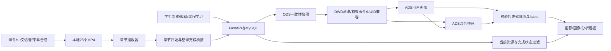

# 答辩演示流程与截图清单

## 9分30秒完整流程

讲解与操作同步进行，不另加10分钟讲稿。事先打开所需标签页，视频只展示30秒片段。

| 时间 | 内容 | 页面及演示要点 |
|---|---|---|
| 0:00–0:40 | 项目背景 | 教育行为、画像、资源推荐与AI辅助教学 |
| 0:40–1:30 | 架构与数据链路 | 展示链路图、冻结批次与质量检查 |
| 1:30–2:00 | 学生登录与首页 | /login → /；首页展示账号及推荐入口 |
| 2:00–3:00 | 个性化推荐及画像 | /recommendations；得分、解释、兴趣、行为统计、批次截止时间 |
| 3:00–3:40 | 查看课程 | /resources → /resources/1069；课程章节与教学目标 |
| 3:40–4:30 | AI课程视频 | /resources/1069/learn；第2章筛选与列转换，播30秒、切换章节、拖至末尾显示提示 |
| 4:30–5:15 | 完成与学习进度 | 解释播放结束只提示，用户确认才完成；展示已有第1章完成及20%进度 |
| 5:15–5:50 | 推荐变化解释 | 展示已完成课程过滤；说明单章不重算评分，后续离线批次才更新画像及排序 |
| 5:50–6:20 | 管理员登录 | admin_demo → /admin |
| 6:20–6:55 | 课程管理 | /admin/courses；课程、章节、资源绑定，不执行编辑 |
| 6:55–8:10 | 行为/画像/推荐看板 | /dashboard；浏览次数、开始/完成学习次数、收藏次数、课程完成率、画像分布、推荐统计 |
| 8:10–8:55 | 正式批次与质量 | 同源批次、ODS/DWD/ADS、校验与历史保护 |
| 8:55–9:30 | 效果与边界 | 视频25/25，闭环完成，样本与离线更新限制 |

本轮禁止数据库写入，因此“完成章节”采用已有完成状态及历史验收证据，不点击确认。未来若授权真实操作，可完成尚未完成的第2章；届时进度可能从20%变为40%，但必须演示前重查状态，不能保证固定值。整门课程完成才触发课程完成桥接与过滤；不要为了演示推荐变化批量完成剩余章节或运行Spark。

管理员画像演示用看板分布/汇总，不虚构不存在的独立用户画像管理页面。推荐变化可用已完成课程不出现在当前推荐中的证据说明，不伪造即时重新计算。

## 必须截图

下列是待采集清单，本轮没有冒充已拍摄。建议后续保存到outputs/defense-screenshots/；避开密码、令牌、浏览器开发者凭证与个人隐私。

| 建议文件名 | 页面 | 展示目的 |
|---|---|---|
| 01-login.png | /login | 登录入口及系统名称 |
| 02-recommendations.png | /recommendations | 推荐得分与推荐原因 |
| 03-course-list.png | /resources | 五门教学课程资源 |
| 04-course-detail.png | /resources/1069 | 章节结构、目标与课程内容 |
| 05-video-playing.png | /resources/1069/learn | 真实视频、代码课件、字幕与章节匹配 |
| 06-learning-progress.png | 同上 | 已完成章节与课程进度，手动确认规则 |
| 07-profile.png | /recommendations | 画像行为统计与兴趣标签 |
| 08-recommendation-source.png | 推荐页面批次信息 | 来源时间边界、完成过滤与结果可信性 |
| 09-admin-courses.png | /admin/courses | 管理端课程/章节维护能力 |
| 10-admin-dashboard.png | /dashboard | 行为统计、画像分布及推荐汇总 |
| 11-spark-pipeline.png | 下方架构图 | 分层清洗与离线推荐闭环 |

历史备份截图在outputs/post-release-browser-acceptance/，包括student-home.jpg、student-recommendations.jpg、student-resources.jpg、course-detail.jpg、chapter-completed.jpg、admin-home.jpg、admin-courses.jpg、admin-dashboard.jpg、admin-batches.jpg，已确认文件存在。旧course-learning.jpg包含缺视频提示，不能用作当前视频效果截图。新视频帧可参考outputs/free-course-videos/chapter-006-frame.png；该帧不是浏览器截图。

